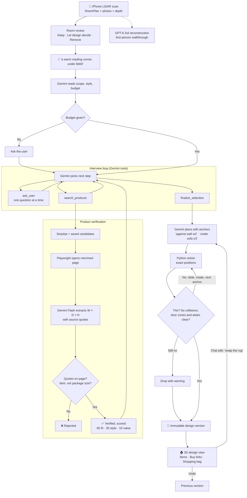
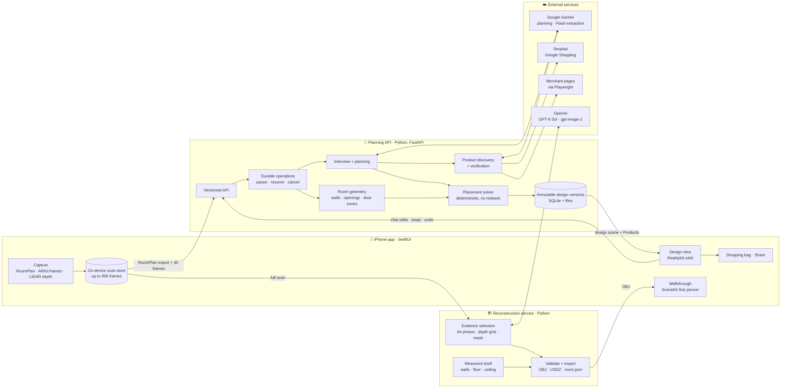

<div align="center">

# 🖼️ ReSpace

**Scan your room with your iPhone, chat about what you want, and see a 3D redesign built from real products that are checked to fit.**

Built with Apple RoomPlan · LiDAR · Gemini API · GPT-6 Sol · SwiftUI · FastAPI

🐺 Built in **DubHacks '26 • ⏱️ <22 hours**


[Demo](#-demo) · [Features](#-features) · [How it works](#-how-it-works) · [Architecture](#-architecture) · [Setup](#-getting-started)


</div>

---

## Overview

Redesigning a room usually means guessing. Inspiration photos of beautiful rooms online are fundamentally different from your own, and you can't tell how to actually buy the items you see in them, let alone check if they'd fit or look good in your room.

ReSpace begins with **your room**. A quick iPhone LiDAR scan creates a rich, precisely measured reconstructed 3D model of your room. You describe the change(s) you want in your words, discuss with an AI designer who might ask some questions, and ReSpace builds an immersive, 3D redesign/preview of your room with real products you can buy in a click. Every product has verified dimensions, and every placement is checked against your walls, doors and walkways.

Our core design rule is as follows: **AI handles taste, language, and appearance; deterministic code handles geometry, facts, and money/cost.** Gemini decides *what* belongs in the room and roughly *where*. A Python solver computes every position, and code verifies every dimension and enforces the budget.

Built at **DubHacks '26** by Kenshu Dieguez, Jason Nishio and Humaid Jaffery · [Devpost](https://devpost.com/software/respace)

## 🎬 Demo

### Demo Video:
[](https://www.youtube.com/watch?v=uYSXpTW6t4o)

### Screenshots:
<p align="center">
  
  
</p>

The app also includes a meeting-room redesign that runs without a server. We removed a round table and three chairs from a real scan and added a soft-seating corner of three real IKEA pieces. Flip **Before/After**, tap any new piece in 3D, and **Buy at IKEA** opens its product page.

## ✨ Features

1. **Scan.** Walk the room for about a minute. Apple's RoomPlan measures walls, doors, windows and large furniture while ReSpace saves photos, LiDAR depth and the room mesh. The scan stays on your phone, so a dropped connection never means rescanning.
2. **Walk through it.** ReSpace rebuilds your room, furniture included, as a 3D model you can explore in first person. **Create realistic image** produces a photo-style picture of the room to share.
3. **Review.** Mark each existing piece **Keep in place**, **Let the design decide** or **Remove from design**.
4. **Say what you want.** One text box: *"a warm reading corner, under $400."* ReSpace infers whether you want a few additions or a full redesign, which styles you mean (or matches what you already have), and your budget. If you don't give a budget, it asks instead of making one up.
5. **Answer a few questions.** The AI designer asks one question at a time: what you do in the room, who uses it, what matters most. Answer in your own words, skip, or tap **Decide for me**. When a choice matters, it shows real listings and explains the trade-off (*"a better couch, or two extra chairs?"*). It can't exceed your budget without your explicit approval. Ollo, our companion, listens, thinks and celebrates along with you.
6. **See your new room in 3D.** Orbit, pan and zoom around your existing furniture plus the new products. Each piece shows its store, price, verified dimensions, why it was picked, swappable alternatives and a Buy link.
7. **Refine by chatting.** *"Move this lamp next to the sofa." "Swap the rug for something cheaper."* Every edit is checked for collisions and walkway clearance. If you ask for two things and only one fits, ReSpace saves the one that works and tells you why the other didn't. Undo is one tap.
8. **Shop and share.** The shopping bag keeps exact links, pack counts and the total. Share price-tagged images and a caption to Messages or Instagram.

## 🧠 How it works



**Gemini never outputs coordinates.** It plans with *anchors*, such as "against wall w2, centred", "under sofa o3" or "in front of the window", and can refer only to walls and objects that exist in your scan. The solver turns anchors into positions.

**No product enters a design without verified dimensions.** A headless browser opens each merchant page and Gemini Flash reads width, depth and height, quoting where each number came from. Code checks that every quote is on the page and does the unit conversion itself. Package sizes, missing measurements and ambiguous variants are rejected. Candidates are scored out of 100: 60 for fit to how you use the room, 30 for style, 10 for value against similar products.

**The solver is deterministic.** It places supports before what sits on them, then applies removals, moves and additions in Gemini's priority order. Every item has a collision class with a 5 cm margin; only rugs may slide under furniture or into door zones. On a collision it slides the item along the wall in 10 cm steps, rotates it 90°, then tries the next-best anchor. Items that still don't fit are dropped with a plain-language warning. For full redesigns, an aisle check keeps every doorway connected to open floor.

**The walkthrough is reconstructed, not hallucinated.** Walls, floor and ceiling come straight from RoomPlan's measurements. Up to 64 sharp, viewpoint-diverse photos, a pooled LiDAR depth grid and a 1,200-triangle mesh go to GPT-6 Sol, which inventories the room and then models objects four at a time, largest first. Code validates every object's geometry. Tokens are counted before each call against a $10 ceiling per generation; in practice a generation costs under $1.

**Layout guidance comes from research.** Every planning, product and edit prompt includes [layout principles](prompts/layout-reasoning.md) we wrote from research on how people use and feel in rooms.

## 🏗️ Architecture



| Component | Stack | What it does |
|---|---|---|
| [`ReSpace/`](ReSpace/) iOS app | SwiftUI, RoomPlan, ARKit, RealityKit, SceneKit | Capture, room review, interview, RealityKit design view with cut-away walls, first-person walkthrough, shopping and sharing |
| [`backend/`](backend/) planning API | Python, FastAPI, Pydantic, NumPy, Gemini, SerpApi, Playwright | Room geometry, AI interview, product discovery and verification, placement solver, durable operations, immutable design versions |
| [`services/reconstruction/`](services/reconstruction/) | Python, OpenAI Responses API (GPT-6 Sol, gpt-image-2), OpenUSD | Walkthrough reconstruction to OBJ and USDZ, photo-style room images |
| [`assets/`](assets/) | Kenney kits, SPAR3D, USDZ | Stand-in furniture and offline image-to-3D conversion for the IKEA demo pieces |

**Capture.** RoomPlan runs the scan while ReSpace samples ARKit frames from the same session (every 0.5 s, 10 cm of movement or 8° of turn, only with good tracking and slow motion, up to 900 frames). Each frame keeps a 2560 px photo, camera pose, intrinsics, and LiDAR depth and confidence when available. Planning receives 40 evenly spaced frames at 1280 px with intrinsics rescaled to match.

**Room model.** Apple's export is converted into our own room model: walls snapped into a closed outline, doors and windows attached to their walls, and a keep-clear zone 1.2 m into the room in front of every door. Existing furniture gets stable IDs, so Keep and Remove always point at the same physical object, and its colour is sampled from keyframe pixels where it's actually visible.

**Durability.** Operations run step by step and survive the app closing or the server restarting; an interview can pause on a question indefinitely. Every committed edit saves a new, unchangeable design version, so Undo simply returns to the previous one. Locally it runs on SQLite and private files; the same code has Postgres, Google Cloud Storage and Cloud Tasks backends for Cloud Run.

## 🚀 Getting started

### Requirements

- macOS with Xcode, and a LiDAR iPhone (iPhone 12 Pro or later Pro models) for real scans
- Python 3.12 for the planning backend; Python 3.11 or 3.12 for the reconstruction service

### 1. Planning backend (offline test mode)

From the repository root:

```sh
python3.12 -m venv .local/venv
.local/venv/bin/pip install -e 'backend[test]'
PYTHONPATH=backend .local/venv/bin/python -m respace.local \
  --data-dir .local/respace \
  --test-model /path/to/room.glb
```

Local mode makes no provider calls by default; planning answers and product listings are simulated. To use real providers, set `GEMINI_API_KEY`, `SERPAPI_API_KEY`, `GEMINI_PLANNING_MODEL`, `GEMINI_EXTRACTION_MODEL` and `GEMINI_SPATIAL_MODEL`, install the browser once with `.local/venv/bin/python -m playwright install chromium`, and add `--live-providers`. Live providers can incur charges. See [`backend/README.md`](backend/README.md) for details.

### 2. iOS app

Open `ReSpace.xcodeproj`, select the **ReSpace** scheme in Debug, and run on a simulator or device. Debug builds point at `http://127.0.0.1:8000`. To reach a backend from a physical iPhone, copy `Configuration/Local.xcconfig.example` to `Configuration/Local.xcconfig` and set this Mac's LAN address.

The bundled meeting-room demo needs no backend at all.

### 3. Walkthrough reconstruction (optional)

```sh
cd services/reconstruction
bash setup.sh
# Add OPENAI_API_KEY to the generated .env
./run.sh
```

The service listens on port 8008 and keeps the OpenAI key off the phone. Point `Configuration/Local.xcconfig` at it, copy the service token from `.env`, rebuild the app, open a saved scan and tap **Create walkthrough**. See [`services/reconstruction/README.md`](services/reconstruction/README.md).

### Tests

```sh
cd backend && ../.local/venv/bin/python -m pytest
```

## 📚 Documentation

- [`SPEC.md`](SPEC.md): the governing product specification and acceptance criteria
- [`CONTEXT.md`](CONTEXT.md): domain glossary (Objects, Items, Additions, Products, versions)
- [`docs/design/`](docs/design/): the DreamSeal design system, screens and UI audit
- [`prompts/`](prompts/): Gemini layout-reasoning prompts and research
- [`AGENTS.md`](AGENTS.md): full map of specs, research and code

## 🔭 What's next

- **Your redesign inside the walkthrough.** The backend can already place products into a reconstructed room and export one 3D file; next is connecting it to the app.
- **Café and small-business mode:** seating targets, table-and-chair groups, 90 cm aisles, and clearance around counters and registers.
- **AR preview** that overlays the redesign on your real room through the camera.
- **Multi-room scans** and sharing a live design with a link.

## 👥 Team

Kenshu Dieguez · Jason Nishio · Humaid Jaffery

Stand-in furniture from [Kenney](https://kenney.nl) ([license](assets/sources/kenney/LICENSE.txt)). Inter typeface under the [SIL Open Font License](ReSpace/Resources/Inter-LICENSE.txt).
