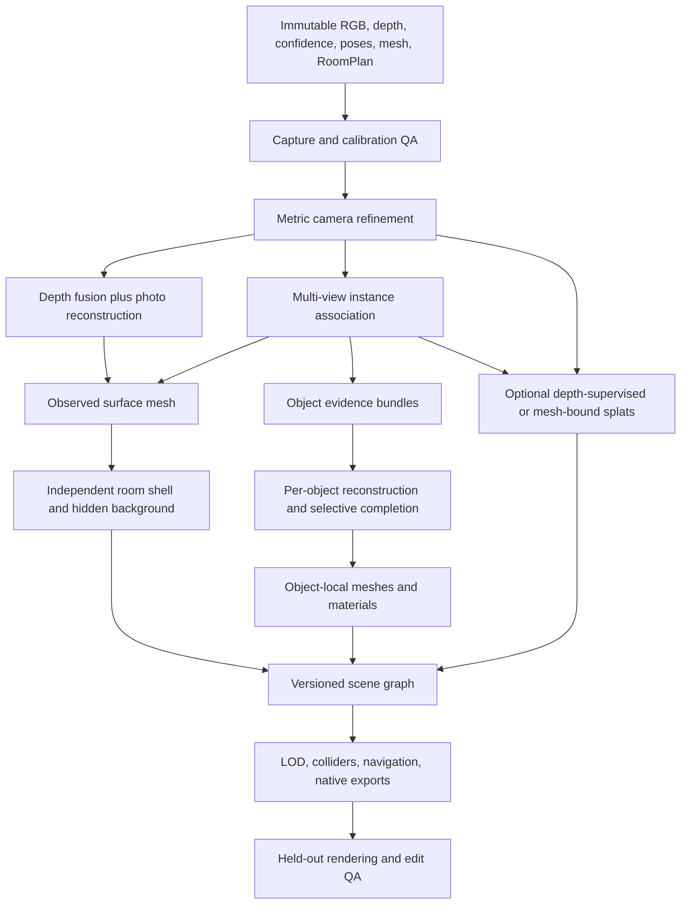

# Editable room reconstruction: capture to explorable scene

Research date: October 17, 2026 (America/Los_Angeles).

Product decisions confirmed during this research: single rooms permanently; only furniture/decor move; fixed room geometry supports texture/material finish changes; generate missing surfaces seamlessly without user-visible estimated labels; present only the finished room. Provenance/confidence/checkpoints discussed below are internal records. They do not authorize partial-model previews or estimated-region UI. Remaining lighting/fidelity/budget/automation decisions are tracked in [the current pipeline](EDITABLE_WALKTHROUGH_PIPELINE.md).

Round-two update: preserve actual furniture plus posters, paintings and whiteboards; lighting is irrelevant to scope, so inverse rendering and shadow-cleanup research below is background only; a broken model requires a rescan. The accepted pilot ceiling is $5 per room and the target is 30 minutes, neither benchmarked. User-facing mask/mesh cleanup and partial-product publication are not the recovery path. The current pipeline supersedes any earlier proposed lighting or correction-UI gates below.

This note researches the reconstruction and delivery stages for ReSpace's requested realistic walkthrough, followed by persistent natural-language edits. It complements [the earlier method survey](PHOTOREALISTIC_PIPELINE_RESEARCH.md). Sources below are first-party documentation, specifications, code, and papers. No reconstruction, commercial service, GPU benchmark, or capture upload was performed. **The pipeline is an engineering proposal; its combined quality has not been demonstrated on ReSpace captures.**

## Recommendation

Use **calibrated RGB-D reconstruction with independent textured mesh instances as the authoritative editable representation**. Preserve metric capture coordinates. Evaluate a depth-supervised or mesh-bound Gaussian appearance layer against that baseline, and add it only if its visual improvement justifies the renderer and editing complexity.

The deliverable is a scene package with an object graph, room surfaces, meshes, material assignments, visibility/provenance, navigation/collision data, and revision history. It is not one fused room mesh or one splat file. Capture fidelity, editable completeness, and realistic lighting are separate quality requirements.

For the conventional path, start with the existing Open3D/OpenMVS worker, add genuine camera refinement, and compare dense photogrammetry against the current TSDF-initialized refinement. For the neural comparison, reproduce DN-Splatter/AGS-Mesh in an isolated environment and use gsplat/Splatfacto as an appearance reference. OMeGa is a research challenger for coupled mesh/appearance, not a replacement already validated for this product.

## What the repository already provides

These are observations of the local source, not claims about the deployed server or scan quality:

| Local source | Existing behavior | Consequence |
| --- | --- | --- |
| [`FrameEncoder.swift`](../../ReSpace/Capture/FrameEncoder.swift) | JPEGs in sensor orientation, per-frame scaled intrinsics, column-major camera-to-scan pose, timestamp; same-frame `sceneDepth` packed as little-endian float16 meters and uint8 confidence | A useful RGB-D substrate already exists. Preserve it rather than reconstructing cameras from screenshots. High-quality JPEG max edge is 2560; ordinary path is 1280. |
| [`geometry.py`](../../services/reconstruction/respace_reconstruction/geometry.py) | `diag(1,-1,-1,1)` camera-axis conversion; anchor-local meshes transformed to scan space; invalid/range-filtered depth; low-confidence samples removed | Existing conversion can become the tested canonical adapter. Medium/high confidence currently receive the same TSDF treatment after filtering. |
| [`pipeline.py`](../../services/reconstruction/respace_reconstruction/pipeline.py) | 15 mm TSDF voxels, 60 mm SDF truncation; COLMAP-format export from supplied poses; OpenMVS `RefineMesh` and `TextureMesh` | The worker does **not** run image feature matching, actual COLMAP bundle adjustment, or dense photo reconstruction. Projected mesh samples do not establish image-derived camera accuracy. |
| Same worker | Conservative small planar repairs and RoomPlan wall/floor completion; opening checks | Good topology guardrails to retain. Completion has to become surface-owned and instance-aware. |
| [`setup.sh`](../../services/reconstruction/setup.sh) | macOS bootstrap downloads OpenMVS v2.4.0 | Newly documented upstream features must not be assumed available in the installed/pinned binaries. |

The encoder does not serialize exposure/white-balance data, camera tracking quality, lens/distortion status, or a precise image/depth registration descriptor. Those are proposed additions where the platform API supplies them; the absence of a field is not proof that an existing scan is unusable.

Preserve the approved [implementation-plan constraints](IMPLEMENTATION_PLAN.md): a 180-second local capture minimum; immutable measured originals for measurements and comparison; and an original/derived dimension-drift flag at `max(5 cm, 2% of the original dimension)`, without discarding the result. Report measured-surface displacement separately. Coverage guidance supplements the minimum duration. The thresholds below concern new quality gates and must not silently replace these approved rules.

## Pipeline and stage contracts



### 1. Capture immutable evidence and reject preventable failures

Save original images, dimensions, per-frame calibration, camera-to-scan transforms, frame/session identifiers, timestamps, depth and confidence formats, mesh-anchor transforms, and RoomPlan JSON. Preserve raw capture and derived versions separately. Record camera tracking/relocalization events, image rotation/cropping/rectification, and capture lighting metadata when available. A session reset must introduce a new coordinate-frame identity rather than silently joining unrelated origins.

Apple establishes that `sceneDepth` is populated from LiDAR at the current frame, with `smoothedSceneDepth` offering temporal smoothing. Its depth is meters; confidence varies with scene and material conditions. Prefer the captured unsmoothed depth for a fusion benchmark and test temporal filtering separately. Confidence labels are quality categories, **not calibrated per-pixel standard deviations**. [Apple scene-depth semantics](https://developer.apple.com/documentation/arkit/arconfiguration/framesemantics-swift.struct/scenedepth), [depth map](https://developer.apple.com/documentation/arkit/ardepthdata/depthmap), [confidence map](https://developer.apple.com/documentation/arkit/ardepthdata/confidencemap)

Proposed capture guidance: a slow connected room pass, return to previously observed features, capture floor/wall junctions and openings, then additional close views around furniture from different heights. Keep furniture/lights static; avoid people and rapid turns. Select frames for sharpness, translation/angular diversity, visible coverage, and reliable tracking. Duration and frame count are insufficient acceptance criteria. Reserve spatially separated evaluation views before optimization.

For a pilot, retain a coverage map and ask for targeted rescans before generation when important objects or newly exposed backgrounds have little evidence. Invisible backs and undersides are not measured merely because a model is watertight.

### 2. Establish calibration and coordinate truth before improving geometry

Define one application frame: `arkit_scan_meters_y_up`, with explicit `scan_from_camera`, `scan_from_anchor`, and `scan_from_asset` transforms. Apple defines ARKit's world as right-handed and camera axes as X right, Y up, Z toward the screen side, independent of UI orientation. Gravity alignment has +Y up. COLMAP stores **world-to-camera** pose, camera X right/Y down/Z forward, quaternion order WXYZ. [Apple camera transform](https://developer.apple.com/documentation/arkit/arcamera/transform), [gravity alignment](https://developer.apple.com/documentation/arkit/arconfiguration/worldalignment-swift.enum/gravity), [COLMAP format](https://colmap.github.io/format.html)

For column-vector mathematics:

```text
F = diag(1, -1, -1, 1)
scan_from_cv_camera = scan_from_arkit_camera * F
cv_camera_from_scan = inverse(scan_from_cv_camera)
p_cv = z * [(u-cx)/fx, (v-cy)/fy, 1]
p_scan = scan_from_cv_camera * [p_cv, 1]
```

The depth is camera-plane Z depth in this unprojection, not Euclidean ray length; Apple's point-cloud sample uses this form. Its sample also demonstrates matching low-resolution depth to image coordinates, and warns that upsampling creates the appearance of additional detail. Preserve invalid depth and confidence edges rather than treating an interpolated depth boundary as a new measurement. [Apple point-cloud sample](https://developer.apple.com/documentation/ARKit/displaying-a-point-cloud-using-scene-depth)

For a pure resize, use `fx'=sx*fx`, `fy'=sy*fy`, `cx'=sx*cx`, `cy'=sy*cy` under the selected pixel convention. A crop, rotation, lens rectification, or different image origin needs its corresponding transformation. Determine whether each stored image is already rectified before assigning a pinhole/distortion model. Test depth/color edge overlays on actual captures; equal aspect ratio does not independently prove registration.

Nerfstudio uses OpenGL camera axes, +Z world up, centered pixel coordinates, and a configurable depth unit scale (millimeters by default). Its parsers may reorient/scale data. An adapter must explicitly record and invert any such transform and convert depth units; exporting float16 meters as if it were millimeters is a 1000× error. [Nerfstudio conventions](https://docs.nerf.studio/quickstart/data_conventions.html)

Required proposed adapter checks: synthetic pinhole round-trip; known front-facing point; textured checkerboard/depth-edge overlay; unit-length reference; portrait/landscape scan; reprojection after export/import; positive determinant/orthonormal pose checks; final mesh/RoomPlan alignment. Audit existing `+0.5` principal-point compensation against the **pinned importer** with rendered overlays rather than spreading it into every format.

### 3. Refine cameras while retaining metric alignment

Run two candidates with identical selected images:

- **Fixed-pose baseline:** existing ARKit poses, genuine image features/matches and triangulation if required by the consumer, then depth fusion/texturing.
- **Refined-pose candidate:** matched image observations, robust camera optimization initialized from ARKit, constrained or realigned to the measured scan frame; validate against held-out RGB and confident depth.

COLMAP documents reconstruction from supplied camera models using feature extraction/matching, `point_triangulator`, undistortion, then dense stereo/fusion. Known poses do not require discarding the image matching step when sparse tracks are needed. Its FAQ also warns that bundle adjustment can change the reconstruction frame; regenerate dependent geometry after changing cameras. [Known-camera reconstruction and frame warning](https://colmap.github.io/faq.html#reconstruct-sparse-dense-model-from-known-camera-poses)

**New upstream option worth testing:** OpenMVS's Usage wiki, updated October 12, 2026, documents `CreateStructure` known-pose input, pose/intrinsics import from a Polycam-style `frames.json`, explicit `arkit`/`opencv` convention, refinement, and similarity alignment back to the input frame. This may avoid a separate SfM frontend. The wiki describes recent behavior changes, so pin source/binary revision and prove the parser and command flags locally before using it. It does not establish ReSpace performance or replace depth residual checks. [OpenMVS known-pose workflow](https://github.com/cdcseacave/openMVS/wiki/Usage#finetune-from-known-poses)

The `develop` source currently declares `--import-poses-mode` with `1=poses+intrinsics`, `--known-poses-convention`, `--export-pose-quality`, and `--export-mvs`; this corroborates the documented interface, not its availability in v2.4.0. The adoption gate is: pin a commit/tag and build/container hash; save the actual executable's help/build output; test an adapter fixture plus a real ReSpace scan; verify image-name matching, intrinsics, camera axes and metric alignment; then record the accepted commands in the benchmark manifest. [CreateStructure source](https://raw.githubusercontent.com/cdcseacave/openMVS/develop/apps/CreateStructure/CreateStructure.cpp)

Proposed decision rule: accept refinement only when feature reprojection and held-out appearance improve without unacceptable measured geometry, scale, or RoomPlan misalignment. An image-only similarity alignment can repair global gauge, but it cannot repair arbitrary local warping. Treat confidence-aware depth/plane constraints as explicit custom optimization work unless a selected implementation supports them. Avoid unconstrained per-image intrinsics unless evidence justifies them; extra degrees of freedom can absorb pose errors.

### 4. Reconstruct observed surfaces: compare three paths

| Path | Strength | Limitation | Role |
| --- | --- | --- | --- |
| RGB-D TSDF + photo texture | Metric measured scaffold and predictable surface extraction | Depth resolution/noise smooths thin/detail geometry; missing views stay missing | Baseline, collision and fallback |
| Calibrated photogrammetry + depth consistency | Photos can recover detail beyond the LiDAR mesh | Blank walls, specular/glass surfaces, repetitive patterns, motion and calibration errors | Main conventional challenger |
| Depth/normal-supervised or mesh-bound splats | Couples detailed appearance with geometric priors | Extraction, hidden completeness, editing and mobile delivery remain separate | Appearance benchmark/hybrid challenger |

Open3D's scalable TSDF integrates posed RGB-D and extracts a mesh by marching cubes. Smaller voxels increase potential resolution and sensitivity to noise; they do not manufacture sensor detail. Its tensor integration supports separate color/depth intrinsics. **Stock legacy TSDF does not automatically turn ARKit confidence values into custom fusion weights.** The current low-confidence rejection is a valid simple baseline; richer weighting needs a confirmed supported API or custom integration. [Open3D RGB-D integration](https://www.open3d.org/docs/release/tutorial/pipelines/rgbd_integration.html), [tensor integration](https://www.open3d.org/docs/release/tutorial/t_reconstruction_system/integration.html)

Proposed fusion refinements: confidence/range/incidence/outlier rejection, conservative boundary filtering, pose-consistent reintegration, and geometry comparison with the exported ARKit mesh. Keep that mesh as independent evidence and initialization; blindly merging duplicate meshes/depth makes double walls and overcounts correlated evidence.

For the photo branch, reconstruct dense observations with the selected MVS tool, reject inconsistency against high-confidence depth/visibility, and refine only supported geometry. OpenMVS separately documents densification, reconstruction, refinement and texturing, plus external depth-map import using its DMAP format. Supplying ReSpace depth requires a tested adapter; neither DMAP import nor `RefineMesh` by itself proves joint RGB-D optimization. [OpenMVS modules](https://github.com/cdcseacave/openMVS/wiki/Modules), [OpenMVS overview](https://github.com/cdcseacave/openMVS)

Do not globally close every hole or impose whole-room watertightness. Preserve doorways, windows, furniture openings, thin elements, and intentional disconnected components. Repair/decimate only within surface ownership boundaries. Every remesh invalidates raw face indices; regenerate ownership for the new asset revision.

### 5. Make surfaces independent objects before promising edits

Produce multi-view instance masks, associate them through calibrated depth and visibility, then label observed surfaces with persistent IDs. Keep ambiguous boundaries unknown. Use class, appearance, projected overlap, and geometry jointly: touching objects and repeated chairs are common merge/split failures. RoomPlan detections are useful seeds/boxes, not the captured furniture's detailed geometry. Apple describes RoomPlan as a parametric floor-plan representation with recognized dimensions/types and USD/USDZ export. [RoomPlan overview](https://developer.apple.com/augmented-reality/roomplan/)

For each instance, retain its masks/source frames, observed mesh, supporting depth, bounds/support relation, reconstruction revision, completion flags, material slots, and local-to-scan transform. Split furniture from room background **before** background fusion/texturing where practical; masking only the finished image leaves ghost geometry and baked texture behind.

Construct the room shell from measured planes/polygons with preserved openings. RoomPlan polygon corners are in local plane coordinates, and surfaces may be curved. Completion must follow those semantics; extending an axis-aligned rectangle over the doorway is a failure. [RoomPlan polygon corners](https://developer.apple.com/documentation/roomplan/capturedroom/surface/polygoncorners), [RoomPlan enhancements](https://developer.apple.com/videos/play/wwdc2023/10192/)

For furniture completion, reconstruct observed sides first. Use observed views for missing regions when possible, a targeted rescan next, then explicitly inferred geometry/materials where required. Never describe generated hidden geometry as a measurement. A particular generation model must be selected by all-view consistency, silhouette/texture preservation, hidden-side usability, and its dependency terms. Broad model lists in the earlier research note are candidates, not a tested stack.

Removing/moving furniture requires **two** completions: the object back/underside and the wall/floor behind its original position. The measured room shell can support hidden wall/floor geometry; use material continuation or controlled multi-view inpainting for appearance. Track observed/inferred regions separately and avoid training against generated fills as if they were independent evidence.

### 6. Separate captured appearance from relightable materials

Create per-instance UV atlases with visibility/occlusion-aware photo projection, view sharpness/frontality selection, color balancing and seam checks. Keep photo references and texture generation parameters so revised geometry can be retextured. Avoid smearing one blurry image across a complete object.

A photo texture captures the illumination, reflections and shadows present during capture. Mark it `captured_appearance`; do not silently claim it is diffuse base color. Initial walkthrough rendering may use a calibrated unlit/captured appearance mode. Editable materials need additional `base_color`, `roughness`, `metallic`, `normal`, and appropriate opacity/emission slots, with uncertainty where inferred.

Full material/light separation is inverse rendering. NVIDIA's first-party nvdiffrec and nvdiffrecmc work explicitly estimates geometry/materials/lighting and documents remaining separation difficulties. These demonstrate that relighting is a distinct optimization problem, not that casual whole-room iPhone captures are solved. Their research licenses must be checked before incorporation. [nvdiffrec](https://github.com/NVlabs/nvdiffrec), [nvdiffrecmc](https://nvlabs.github.io/nvdiffrecmc/)

Proposed scope: ship plausible material edits with approximate lighting first; validate shadow cleanup and a new contact shadow when moving furniture. Exact light transport, mirror updates and photographically perfect relighting are a separate research gate. Multiplying a wall's baked RGB by green can preserve unwanted old tint/shadow; copying its image into a PBR slot does not fix that.

### 7. Evaluate Gaussian appearance without making it the scene database

Splatfacto is a Gaussian renderer/trainer based on gsplat. Its documentation supports PLY splat export and explicitly says mesh/point-cloud export is unsupported. It lists approximate 6 GB/12 GB memory configurations, not a guarantee for ReSpace's chosen image count/resolution. [Splatfacto documentation](https://docs.nerf.studio/nerfology/methods/splat.html)

DN-Splatter/AGS-Mesh explicitly targets smartphone RGB-D, depth/normal supervision, and mesh extraction, with custom Nerfstudio-format datasets. It is a closer input match than generic RGB-only 3DGS. Reproduce its pinned environment independently; confidence filtering options do not prove direct compatibility with ReSpace confidence binaries. [DN-Splatter/AGS-Mesh source](https://github.com/maturk/dn-splatter)

OMeGa jointly optimizes an explicit mesh with face-bound 2D Gaussians. Its public setup requires CUDA/PyTorch, COLMAP data, normal maps and an initial mesh workflow. Substituting ReSpace's measured mesh is a proposed adapter experiment, not a verified path. The small research implementation and dependencies need reproduction and licensing review. [OMeGa](https://github.com/Hao7un/OMeGa)

Current gsplat main advertises Gaussian contributor/ID queries and broader sensor support, useful ingredients for ownership/visibility. Its README distinguishes changes since v1.5.3 from PyPI availability; pin the actual implementation. Generic LiDAR sensor support is not a turnkey ARKit indoor reconstruction endpoint. [gsplat](https://github.com/nerfstudio-project/gsplat)

For an optional hybrid renderer, keep per-instance ownership and suppress the original object's entire splat group when replacing it. Transform means **and** covariance/orientation, and account for the direction basis of view-dependent appearance. Recoloring/deleting subsets alone cannot synthesize unseen background or correct captured lighting. Compare edited views, not only the unedited splat demo.

MetalSplatter supplies a Swift/Metal Gaussian viewer for Apple platforms with common splat formats under MIT terms. It does not turn splats into a normal RealityKit/SceneKit mesh. Test mixed splat/mesh depth, sorting/transparency, picking, loading and memory on target iPhones. [MetalSplatter](https://github.com/scier/MetalSplatter)

### 8. Package for navigation and persistent editing

Suggested authoritative package (schema proposal):

```text
scene.json                    # schema, capture, revision, metric frame, asset graph
cameras/refined.json           # exact cameras + transform to original scan
shell/<surface_id>.glb         # independent walls/floor/ceiling/openings
objects/<instance_id>/*.glb     # local-space meshes, LODs, UV/material slots
appearance/*                  # optional Gaussian assets and ownership
collision/*                   # simplified shell/object collision geometry
navigation/*                  # walkable topology or floor-region representation
provenance.json               # observed/inferred, sources, confidence, revisions
quality.json                  # metrics, failures, capabilities, rescan guidance
```

glTF provides meters, node transforms/hierarchy, and material/mesh assets. Node names are not guaranteed unique; keep application IDs and revisioned mappings in `scene.json`, using node extras only as a convenience. USDZ is an Apple delivery alternative subject to importer/material round-trip tests. A `.ply` can mean a point cloud, mesh or custom Gaussian schema; its extension establishes no interchange semantics. [glTF specification](https://registry.khronos.org/glTF/specs/2.0/glTF-2.0.html)

Generate object-local LODs and optimize without crossing instance, UV or material boundaries. meshoptimizer supplies simplification, mesh optimization and compression; selecting error/texture budgets remains product engineering. [meshoptimizer](https://github.com/zeux/meshoptimizer)

Use separate simplified colliders rather than high-detail render surfaces or Gaussian centers. For a normal standing-height walkthrough, derive walkable floor and clearance from the measured shell and obstacle instances. Recast creates navigation meshes from triangle geometry and Detour supplies path queries; it is Zlib licensed. A small room may only need a simpler floor polygon plus obstacle tests. Recompute changed obstacle/navigation data on edits, preserving portal clearance. [Recast/Detour](https://github.com/recastnavigation/recastnavigation)

The natural-language system should request versioned scene operations, not regenerate the entire room after every request. Applying transforms/material overrides should be immediate; geometry completion/retexturing can be asynchronous jobs publishing a new asset revision. Maintain undo, stable IDs, source capture, and capability flags (`move_ready`, `material_edit_ready`, `background_complete`) so unsupported edits are explicit.

## Hardware and license gates

These are implementation constraints, not a cloud quote or legal clearance:

| Component | Verified constraint | Action |
| --- | --- | --- |
| Conventional SfM/MVS | COLMAP's official FAQ excludes its dense reconstruction from non-CUDA functionality; sparse stages can run CPU. OpenMVS offers CPU paths, with GPU/build details depending on version. | Keep CPU baseline; benchmark an isolated Linux NVIDIA worker for dense/neural experiments. [COLMAP GPU FAQ](https://colmap.github.io/faq.html#available-functionality-without-gpu-cuda) |
| Neural candidates | gsplat and OMeGa require CUDA paths; actual image/point count and settings determine VRAM/time. | Proposed starting benchmark: 24–48 GB VRAM and 64 GB host RAM, **an estimate**, not a published minimum for all stages. Measure peak use and GPU-hours. |
| OpenMVS | AGPL-3.0 terms. Network deployment/modification obligations require review of the actual integration. A subprocess is not an automatic exemption. | Keep as current quality baseline; resolve deployment obligations or choose/license an alternative before product launch. [License](https://github.com/cdcseacave/openMVS/blob/master/LICENSE) |
| Original 3DGS lineage | Original implementation uses a custom research license. | Prefer a reviewed gsplat code path; audit inherited modules/checkpoints individually. [Original license](https://github.com/graphdeco-inria/gaussian-splatting/blob/main/LICENSE.md) |
| nvdiffrec | Reviewed license limits others to noncommercial research/evaluation. | Research reference only until replacement/permission; do not silently ship it because adjacent repos have permissive badges. [License §3.3](https://github.com/NVlabs/nvdiffrec/blob/main/LICENSE.txt) |

Pin all tool/model revisions, image digests and weight hashes. Separate orchestration from compute workers, checkpoint every expensive stage, preserve logs/artifacts, and retry deterministic failures only after a change. Do not provision GPU resources or promise latency from paper demo numbers before the benchmark.

## Quality gates and failure handling

The following are proposed tests/metrics; numerical thresholds need product agreement and real capture calibration.

| Gate | Measure | Failure response |
| --- | --- | --- |
| Capture/calibration | Blur/coverage, tracking, reprojection overlay, units/orientation, depth/color alignment | Targeted rescan or correct adapter; do not spend GPU-hours fitting a flipped camera model |
| Camera/geometry | Held-out RGB; confident depth residual distributions; metric alignment; duplicate surfaces; openings and thin features | Retain fixed-pose baseline, reject bad refinements, report unsupported regions |
| Appearance | Held-out PSNR/SSIM/LPIPS plus human review of texture fidelity/seams/new paths | Inspect capture, pose and photometric errors before adding triangles |
| Identity | Manually labeled instance subset, projected mask IoU, repeated-object split/merge rate | Correct association; regenerate ownership after mesh revision |
| Completeness | Coverage/provenance per instance and newly exposed background | Additional observations or explicit inferred completion |
| Editing | Hide/move/rotate an original chair/sofa; recolor a wall; asset replacement; save/reopen/undo | Reject edits with ghosts, holes, floating contact, unstable IDs or unrecoverable revisions |
| Navigation | Connected valid paths, obstacles, portal clearance, camera near plane, floor contact | Repair colliders/navigation independently from visual mesh |
| Delivery | Real-phone frame time/memory/load/download size, material/coordinate round trip | Reduce LOD/atlas/splat count using measured error; retain portable mesh fallback |

Evaluate at least a simple room, clutter/repeated furniture, and difficult reflective/thin surfaces. Keep both captured and post-edit evaluation routes. Hidden-surface correctness needs extra evidence; no image similarity score from the original viewpoint proves it.

## Implementation order

1. Build a reproducible capture adapter and benchmark runner over existing scans; verify calibration with overlays before optimization.
2. Compare fixed vs refined cameras and TSDF-initialized vs photo-dense conventional meshes. Test the newly documented OpenMVS known-pose path only in a pinned separate environment.
3. In parallel experiments, compare Splatfacto appearance and DN-Splatter/AGS-Mesh geometry using identical train/held-out frames. Promote OMeGa only after reproduction.
4. Establish persistent instance ownership and an editable room shell, then test one original furniture object end to end: segment, reconstruct, complete, hide/move, fill background, retexture, save/reopen.
5. Optimize mesh-native delivery and interaction. Add hybrid splats only when measured fidelity benefit survives the actual editing tests.
6. Add transaction-based language tools on top of the scene contract. The language model selects edits; reconstruction, rendering and geometry validation remain deterministic engine responsibilities.

**Unresolved by public sources:** achievable fidelity from the retained ReSpace JPEGs, actual ARKit pose drift/registration, best completion method for the user's furniture, casual-scan material/light separation, edited hybrid rendering quality, and per-room cost/latency on target hardware. The benchmark closes those gaps; no current public method removes the need to measure them.
