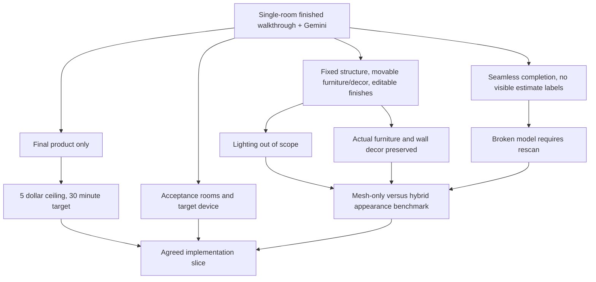
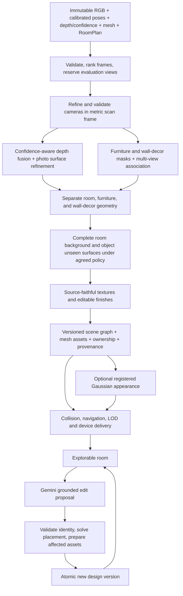

# Editable room walkthrough pipeline

Research and design date: October 17, 2026, America/Los_Angeles.

**Status: scope agreed; implementation authorized on `scan-pipeline-redo`.** The user completed the requirements rounds and explicitly authorized using this repository and current branch, with no work on `main`. This document specifies an end-to-end pipeline; it does not claim that its new stages are implemented or that real-room quality has passed. Existing capture and reconstruction behavior remains the baseline until implementation evidence is recorded.

**Latest scope steering:** implement and validate the complete explorable reconstruction and object segmentation first. Gemini editing will be added later; the Gemini/executor sections below are future integration contracts, not part of the current implementation deliverable. No Gemini credentials or setup are required for this work. Current comparative follow-up research is in [completion models](COMPLETION_MODEL_DECISION.md) and [segmentation models](SEGMENTATION_MODEL_DECISION.md).

Actual code, local model experiments and unresolved implementation gates are recorded in [implementation status](IMPLEMENTATION_STATUS.md). Read that separately from this design: the finished-room path is now wired; real LiDAR-device quality and the optional GPU completion models are not yet validated.

## Intended result

Create a photorealistic, freely explorable representation of the captured room, with persistent three-dimensional edits driven by Gemini. Photos supply observed appearance; calibrated depth and meshes supply geometric evidence; the application owns scene identities, asset revisions, placement, and saved designs. Natural-language edits must alter the same persistent scene from every viewpoint.

The proposed default is **a calibrated, segmented, photo-textured mesh scene**, with a Gaussian-splat benchmark to determine whether a hybrid appearance layer is worth the additional renderer and editing complexity. Segmentation, unseen-surface completion, and background repair are explicit stages. Lighting simulation, relighting, and shadow cleanup are outside the requested scope. No general-purpose language model is treated as the reconstruction engine.

See the companion [reconstruction evidence](EDITABLE_RECONSTRUCTION_RESEARCH.md) and [editable-scene evidence](EDITABLE_SCENE_RESEARCH.md) for primary sources and alternatives. The earlier [research report](PHOTOREALISTIC_PIPELINE_RESEARCH.md) supplies broader candidate coverage; the existing [implementation plan](IMPLEMENTATION_PLAN.md) records the currently implemented worker and previously approved constraints. New recommendations here do not silently supersede that plan.

## Decisions and interview tree

Established from this conversation: the output is a realistic walkthrough, the scene must be editable, and Gemini is the intended natural-language editing interface. Round one further settles the permanent single-room scope, fixed room structure, movable furniture/decor, texture-based finishes, seamless generated completion without visible estimate labels, and final-product-only presentation.

Inherited constraints documented in the current implementation plan: retain original metric observations; a three-minute capture minimum; flag derived dimension drift beyond `max(0.05 m, 2% of reference length)`; preserve recoverable partial artifacts internally. The earlier scope allowed geometric repair without generative furniture completion. The user's round-one answers now authorize seamless completion where observations are missing and supersede user-facing partial/preview presentation for this pipeline. Existing implementation evidence remains historical, not proof that the new behavior is built.

Round-one decisions:

| Decision | Accepted answer | Status |
| --- | --- | --- |
| Movable content | Furniture and decor only; room structure stays fixed | Accepted |
| Finishes | Wallpaper, paint, tile and other texture/material changes without changing room geometry | Accepted |
| Unseen surfaces | Generate seamless completion without user-facing estimated markers | Accepted |
| Processing experience | Show only the finished product; users may wait during processing | Accepted |
| Capture scope | Single rooms permanently, rather than a temporary first-release restriction | Accepted |

Internal source/recipe/provenance records remain useful for reprocessing and do not create visible overlays, badges, labels, or interruptions. No estimated-region UI is part of the product. A processing indicator is not an intermediate room preview.

Round-two decisions:

| Decision | Accepted answer | Consequence |
| --- | --- | --- |
| Furniture fidelity | Preserve actual captured furniture | Do not substitute a similar catalog item or invent visible fabric/details |
| Wall decor | Include posters, paintings, and whiteboards | Give each independent geometry/identity and preserve its source appearance |
| Lighting | Lighting does not matter | No relighting controls, inverse rendering, light estimation, or shadow-cleanup acceptance gate |
| Broken reconstruction | Request a rescan | No user mask/mesh cleanup workflow or broken final model |
| Processing budget | Accept the proposed $5 per-room ceiling | Account for the room pipeline and retries; stop before overspend |
| Processing target | Accept the proposed 30-minute target | Measure actual performance; this is a target, not a demonstrated runtime or hard failure deadline |

Round-three decisions:

| Decision | Accepted answer | Consequence |
| --- | --- | --- |
| Devices | LiDAR-equipped phones only | Require actual LiDAR/depth/mesh capabilities; retain existing iOS 18+ baseline |
| Built-ins | Built-in items stay fixed | Cabinets, counters, doors and windows are not movable redesign items |
| Implementation | Use this repo and branch; NO MAIN | Implement on `scan-pipeline-redo`, preserving existing work |

The requirements frontier is closed. The user's explicit implementation authorization confirms the shared scope. The proposed 30 FPS device target remains an engineering benchmark target rather than a separately confirmed numerical product requirement. Representation/model selection is a bounded engineering experiment, not an unanswered product decision.



The product boundaries are settled. The selected methods must preserve the actual furniture and wall decor inside the accepted budget; a more elaborate research model is not automatically a viable choice. Runtime, cost, and fidelity still require real-capture measurements. No numerical target in this document is a benchmark result.

## What exists and what changes

The repository already captures JPEGs, camera calibration/poses, depth/confidence, RoomPlan data, and an ARKit mesh. Its separate reconstruction service validates an immutable upload manifest, fuses depth with Open3D, repairs bounded room surfaces, and runs OpenMVS refinement/texturing. Its processed-room viewer imports a textured OBJ. These are useful foundations.

The new pipeline must add or verify: photo-based camera refinement; image-quality and coverage selection; multi-view instance segmentation; separate room, furniture, and wall-decor assets; ownership of geometry and textures; selective completion; background visibility after removal; texture/material edits; one scene revision shared with the editing path; collision-aware walkthrough navigation; and physical-device visual acceptance. Existing semantic design items and their stand-ins are not evidence that captured furniture can already move.

Concrete source audit, without running reconstruction or inspecting private photographs:

| Area | Verified source and limitation |
| --- | --- |
| Capture | `ReSpace/Capture/FrameEncoder.swift:11` serializes same-frame RGB/depth/confidence/calibration; `SamplingPolicy.swift:10` bounds frame retention but does not score blur or coverage |
| Geometry inputs | `services/reconstruction/respace_reconstruction/pipeline.py:305` loads the original ARKit mesh as the comparison reference; the current TSDF output is reconstructed from depth, not a joint fusion of the mesh and RGB-D |
| Confidence | `services/reconstruction/respace_reconstruction/geometry.py:47` rejects low-confidence depth; medium/high samples receive equal TSDF treatment, rather than custom confidence-weighted fusion |
| Photos | `pipeline.py:47` exports supplied cameras to COLMAP format; `pipeline.py:130` refines/textures the existing mesh without feature-based bundle adjustment or a dense photo reconstruction stage |
| Scan viewer | `ReSpace/Rendering/ProcessedRoomScene.swift:6` imports a whole-room OBJ; `ReSpace/Rooms/LocalRoomPreviewView.swift:179` uses generic camera controls |
| Design viewer | `ReSpace/Rendering/RoomSceneController.swift:74` implements orbit/pan/zoom; its semantic objects are not linked to segmented captured geometry |
| Asset scale | `RoomSceneController.swift:183` can independently scale normalized asset axes; measured furniture requires a distinct rigid/validated uniform-scale path |
| Backend boundary | The checked-in FastAPI service implements reconstruction. Client chat/Undo contracts and lifecycle mocks exist, but there is no checked-in Gemini planner, placement solver, or complete design backend |
| Captures available | One retained manifest has 296 images at 2560×1440 over approximately 180 seconds, but its local job is still `uploading`; completeness and visual quality are unverified |
| Existing verification | Synthetic geometry/service and portable Swift tests cover useful contracts, but exclude physical camera capture and visual/device acceptance |

The scan frame and canonical design-room frame are also distinct. Carry the existing server-supplied `scanToRoomTransform` (`RoomModels.swift:27`) through scene assembly and test inverse/round-trip alignment. Design object sizes use `[width, depth, height]`, positions use `[x,y,z]`, and asset forward is `+Z`; blindly copying axis orders or independently recentering each room breaks that contract.

### Initial tool selection, subject to the benchmark

| Responsibility | Baseline | Challenger or adoption gate |
| --- | --- | --- |
| Capture | Existing ARKit/RoomPlan evidence bundle | Backward-compatible quality/calibration metadata |
| Camera alignment | Existing fixed poses as comparison | Pinned COLMAP or current OpenMVS known-pose frontend; actual reprojection/metric checks |
| Observed geometry | Existing Open3D TSDF + OpenMVS texture/refinement | Genuine photo-dense geometry and depth-consistency evaluation |
| Instances | Grounding DINO discovery + SAM 2 prompted masks + application-owned multi-view association | RoomPlan supplies priors; SAM 3 after access/hardware/terms checks; failed automatic ownership leads to rescan, not a user cleanup screen |
| Hidden surfaces | Observed elsewhere, then constrained room-surface continuation | Generative object/background completion only under agreed policy and all-view checks |
| Object completion | Preserve observed surfaces; no silent generic furniture substitution | Pixal3D multi-view first external experiment; WorldSculpt geometry-only second; TripoSR local runtime smoke only; see the completion decision |
| UVs and mobile meshes | Existing photo texturing; explicit owned UV regions | xatlas/meshoptimizer where useful, with ownership remapping |
| Runtime | Keep SceneKit inspector as baseline; integrate actual assets into existing RealityKit design path | Device-tested USDZ conversion; no renderer migration assumed complete |
| Appearance experiment | Photo-textured mesh | gsplat/Splatfacto reference, DN-Splatter/AGS-Mesh surface comparison; hybrid only after edit/device gates |
| Navigation | Simple floor and obstacle geometry for one room | Recast/Detour if topology/path requirements justify it |
| Intent | Gemini with semantic references | Deterministic application executor remains commit authority |

These are specific experiments, not a promise that combining package names produces complete objects automatically. Isolate incompatible research environments and pin each reproducible recipe. Primary evidence and licenses are detailed in the two companion research notes.

## Non-negotiable data invariants

1. Raw observations are immutable. Every derived product references its source capture and calibration revision.
2. The captured room and the edited design are distinct. Design changes never rewrite the capture or alter original measurements.
3. Instance identity is application-owned. Triangle indexes, Gaussian indexes, and exporter node order are representation-specific and cannot be permanent object IDs.
4. Every visible surface has an owner: an identified room surface, an object, or an explicit internal unassigned region. Uncertain clutter is retained, not arbitrarily merged into the nearest chair. Room surfaces permit finish changes; only movable furniture/decor permit placement edits.
5. Generated geometry and appearance remain distinguishable from observations internally, without user-facing estimate labels. A model confidence score is not a calibrated probability of physical truth.
6. No scene is declared editable merely because the whole mesh can rotate. An object needs separable render geometry, ownership, placement metadata, and a background that survives its removal.
7. Unsupported edits produce a useful explanation or clarification. An attractive image from one viewpoint is not successful execution of a three-dimensional edit.

## Pipeline graph



### Stage 0: immutable capture and quality guidance

Keep the current stored scan and measured diagnostic render internally; do not present it as an intermediate room. Prefer complementary sharp views at several heights over repeated images from the same position. Retain the existing duration requirement until deliberately changed; duration alone never proves adequate coverage. Moving people, exposure changes, glass, mirrors, and thin furniture require appropriate quality checks, masking, and focused rescan guidance if processing cannot succeed.

Record existing frame IDs, timestamps, sensor orientation, image dimensions, scaled intrinsics, camera-to-scan transforms, depth/confidence dimensions and formats, source mesh, and RoomPlan export. Extend the capture schema compatibly to record available tracking quality, exposure/white-balance information, exact depth source, color encoding, camera model/distortion status, and capture/calibration versions. Record unavailable fields as unknown; do not fabricate them for older captures. Depth upsampling does not create additional measured detail. [Apple depth sample](https://developer.apple.com/documentation/arkit/displaying-a-point-cloud-using-scene-depth)

Output: verified capture manifest and coverage/quality report. Reserve spatially separated evaluation images before training, segmentation-based tuning, or texture optimization. A selected image may be excluded from fitting yet remain available only to the evaluator.

### Stage 1: calibration and metric registration

Reject corrupt files, mismatched dimensions, non-finite values, invalid intrinsics, reflected/nonrigid transforms, and unsupported formats. Check color/depth synchronization and registration using actual reprojected depth edges. Do not treat ARKit's confidence categories as continuous calibrated sensor uncertainty.

Preserve the existing right-handed, meter, Y-up scan frame. Explicitly distinguish camera-to-world and world-to-camera matrices and record serialization order. For the conventional image-camera frame with X right, Y down, Z forward, the ARKit camera basis change is `diag(1,-1,-1,1)`. Each adapter must verify this against rendered projection overlays; a basis change must not be applied twice. Apple's camera transform is orientation-independent, while image-plane intrinsics are in pixels. [ARCamera transform](https://developer.apple.com/documentation/arkit/arcamera/transform), [ARCamera intrinsics](https://developer.apple.com/documentation/arkit/arcamera/intrinsics)

For a registered axial-depth sample `d` and depth-plane calibration `K_d`, the proposed adapter computes `p_scan = T_scan_from_arkit_camera * F * [d * K_d^-1 * (u,v,1), 1]`. Resize calibration using the actual image/depth scaling and pixel-center convention; do not assume that changing image dimensions leaves intrinsics unchanged. Validate the actual serialized depth semantics before using this formula for all sources.

Compare the fixed-ARKit baseline against feature matching and bundle adjustment initialized/constrained by ARKit poses and confident metric depth. Align any optimized model back into scan coordinates; record similarity corrections and reject unexplained scale/reflection drift. Evaluate current OpenMVS known-pose tooling against COLMAP in an isolated pinned environment; upstream documentation does not mean the installed worker already supports it. Use the better aligned solution only if source-view reprojection, depth residuals, and held-out views improve without unacceptable metric drift.

Output: versioned cameras/calibration, per-frame inclusion reasons, alignment transform, reprojection/depth reports. Failure: retain the original calibrated-depth route, label the result as baseline quality, and request improved capture if useful camera overlap is absent.

### Stage 2: observed room geometry

Reuse Open3D TSDF fusion as the deterministic geometric baseline. Filter invalid depth and use its confidence evidence; avoid averaging across depth discontinuities or erasing thin structures. Record integration parameters, resolution, masks, and preprocessing. The existing 1.5 cm voxel setting is a baseline to benchmark, not the maximum possible detail.

Compare photo-dense reconstruction and mesh refinement against that baseline. Confidence-aware depth is a metric prior, not a hard constraint forcing RGB onto noisy LiDAR. Clean obvious outliers and degenerate faces without turning every topological opening into a repair target. Preserve doors, windows, furniture gaps, and thin geometry. Retain the observed mesh and any repaired mesh separately.

Use the uploaded mesh as an independently preserved geometry prior, metric comparison, and validated fallback for observed regions where frame-depth coverage is unavailable. The final ARKit mesh and frame depth may derive from the same underlying sensor evidence; do not count them as independent confirming measurements or blindly fuse duplicate surfaces. Any replacement of a depth-derived region by a mesh-derived region records source ownership and passes the same alignment/visibility checks.

Output: metric observed mesh, visibility/coverage evidence, RoomPlan surface/opening associations. Failure: preserve usable measured geometry internally with diagnostics; retry an alternative reconstruction or request a focused rescan rather than publish an incomplete room.

### Stage 3: persistent instance reconstruction

Generate image-space instance masks with a reproducible segmentation stack; SAM 2 is a simpler baseline, while SAM 3 is a candidate subject to access, hardware, and terms. Use RoomPlan objects as coarse priors, not precise mesh masks. Associate masks across views using calibrated projection, depth/occlusion, 3D overlap, appearance, category, and support relationships. Adjacent identical chairs must remain different instances. Video tracking IDs are not automatically room-wide persistent IDs.

Maintain a reviewable ownership distribution during fusion and publish discrete ownership only when justified. Split mesh faces at ownership boundaries rather than assigning an entire mixed triangle to one object. Use visibility-tested votes so a sofa mask does not claim the wall behind it. Retain ownership after retopology via explicit remapping; do not assume triangle indices survive simplification.

Assign permanent IDs after association, with explicit split/merge lineage for reconstruction revisions. Use automatic consistency checks; any diagnostic correction tools are internal development tools, not a user cleanup screen. Research does not establish reliable unattended segmentation of every cluttered room, so a failed result requires a focused rescan rather than publishing uncertain items as if they were fully editable.

Output: instance registry, frame mask observations, mesh-face ownership, uncertain regions, RoomPlan-to-instance mapping, and object evidence bundles. Failure: retain evidence internally and request a focused rescan if a required movable item cannot be isolated reliably. Locked ambiguous clutter is not a substitute for the requested editable furniture/decor.

### Stage 3a: posters, paintings, whiteboards, and other wall decor

Wall decor is not part of the wallpaper or an interchangeable generated texture. Detect/promote these items independently even when RoomPlan does not identify them. Associate repeated observations by wall support, calibrated geometry and source appearance, keeping adjacent posters distinct. Reserve close, sharp source views so artwork, board markings and text remain as legible as the observations allow; never use a generative model to rewrite existing poster artwork or whiteboard content.

For a planar item, estimate its boundary and supporting wall plane, reconstruct the observed metric outline, rectify the best source views into a local texture, and retain visible frame/edge thickness where supported. A poster can be a thin textured surface; a painting or board needs its observed frame and thickness where visible. This is a geometry/texture representation choice, not a license to replace the actual item. Avoid Z-fighting using correct separate support geometry and renderer-tested depth handling.

Give wall decor its own instance ID, local frame, material/UV ownership, source observations and wall-support relationship. Keep wall finish textures free of duplicated poster/board imagery. Repainting or applying wallpaper must preserve wall decor; moving/removing a poster must reveal a seamless wall at the old position. Validate the support and orientation of its new wall placement and preserve its actual scale. Classifying a whiteboard as movable decor does not add an interactive whiteboard-content editor to this scope.

The rectification and robust planar-association methods are supported by [OpenCV's homography documentation](https://docs.opencv.org/4.x/d9/dab/tutorial_homography.html). The full wall-decor algorithm, source contracts and tests are detailed in [the wall-decor research section](EDITABLE_SCENE_RESEARCH.md#9-preserve-actual-posters-paintings-and-whiteboards). The detector, metric support recovery, and persistent entities remain ReSpace integration work rather than capabilities delivered by homography alone.

### Stage 4: object-local geometry and selective completion

Extract observed object geometry in a local frame with explicit support/pivot/orientation. Preserve furniture visible surfaces and texture evidence. Reconstruct additionally observed sides from the original multi-view images before considering generation. Store the original transform independently of the render asset so transform edits do not modify vertices in place.

Seamless completion is authorized. Compare a reproducible multi-view completion candidate with a single-image generative candidate on the same objects. Fit candidates against observed silhouettes, valid depth, contact points, and multi-view appearance. Preserve the reliable observed region; reject generated replacements that change distinctive visible shape or fabric without the user's intent. Do not nonuniformly stretch a generated chair merely to pass bounding-box checks.

If a candidate fails, retain its observed evidence internally and try the next bounded completion path. Request a focused rescan if necessary, or offer an explicitly different replacement asset only if the user accepts that change. Do not show an incomplete object as the final room or silently swap in generic furniture.

Output: observed object asset, optional completed candidate, source-view support, support/contact data, collision proxy, completion provenance, and edit capabilities. Whole-object generation is not mandatory for material-only edits of a confidently segmented room surface.

### Stage 5: room shell and newly exposed background

Reconstruct fixed room surfaces from observations, constrained by measured room planes and opening polygons. Remove object-owned geometry from the background representation. Use a separate clean background asset so the same sofa does not remain baked into a supposedly empty room.

After removing an object, first recover any background visible in other images. Where no evidence exists, use constrained planar continuation and existing material evidence under the agreed policy, then more advanced surface-aware completion only if it improves cross-view quality. Treat geometry and texture provenance separately: a measured wall plane can still have generated wallpaper. Preserve aperture boundaries and real alcoves; a floor plane is not a license to fill stairwells.

Compute which background regions each movable object may expose, including the wall behind posters and boards. An edit is ready only if those regions are renderable and seamless; incomplete-room previews are outside the accepted experience. Remove original object/decor appearance from all representations, including splats and atlases. Captured shadows or reflections may remain because lighting realism is explicitly outside scope; do not build inverse rendering or shadow cleanup as release dependencies.

Output: fixed room shell, per-surface materials, hidden-background patches, source provenance, and per-object background dependencies. Failure: keep the object in place or report the affected edit as incomplete; do not publish a ghosted or missing-floor result as complete.

### Stage 6: observed appearance and editable finishes

UV-unwrap per object/surface or produce atlases with unambiguous ownership and padded islands. Texture from visible, sharp, well-aligned photos with exposure/color harmonization and seam control. Retain high-quality source evidence independently of mobile texture compression. Use correct texture color spaces and simple captured/unlit appearance where appropriate; no lighting-estimation stage is required.

Two different appearance responsibilities must be represented explicitly:

- Captured appearance preserves real furniture, artwork, and board content in photographs. It is the fidelity baseline; captured illumination may remain baked in.
- Editable finishes replace/recolor selected wall/floor surface textures while protecting furniture and decor. Basic material maps may be used where convenient, without estimating physical light transport.

A finish edit must operate on the selected surface/material region, preserve appropriate detail, and show consistent results from multiple views. Wallpaper and tile changes use texture/material parameters, including physically scaled UV repetition and optional normal/roughness detail; they do not modify the room's architectural geometry. Full physical relighting, light controls, and shadow/reflection correction are excluded by the user's lighting decision. Generated images never count as saved 3D edits.

Output: versioned materials/textures, original/editable render assets and independent decor bindings. Failure: keep the last finished design and report the failed finish edit; do not overwrite source furniture/artwork with generated content.

### Stage 7: scene assembly and optional Gaussian appearance

Assemble a scene graph whose entities reference object-local assets, materials, semantic labels, transforms, support relationships, edit capabilities, and provenance. Walls and floors require their own selectable surface IDs; furniture-only item lists cannot express painting a particular wall.

Benchmark a depth/surface-aware Gaussian appearance layer against the photo-textured mesh using identical held-out views. If the mesh meets the visual target, retain the simpler mesh path. A splat path is adopted only after it improves real-room appearance and passes mobile memory/frame-rate and edit-artifact gates. A pure splat export is not the editable database or collision model.

For a hybrid, both representations must share stable instance ownership and the exact scene frame. Hide an edited object's original splats, compose mesh/splat depth correctly, and preserve color and complete background. Transform Gaussian centers, orientations/covariances, and view-dependent appearance consistently when supporting object-level splat transforms. Physically correct light/shadow changes are not an adoption gate. If object isolation or compositing fails, prefer the mesh representation rather than introducing broken edited scenes.

### Stage 8: walkthrough navigation and delivery

Build collision proxies and traversable floor/navigation data from fixed geometry plus current object placements. Use a camera capsule or equivalent swept movement test, validate spawn positions and headroom, preserve door openings, and prevent movement through walls/furniture. Recompute affected occupancy when objects move. An orbit camera alone does not satisfy a walkthrough.

The explorable envelope is bounded by supported or explicitly completed geometry. Block entry into unmodeled space with a clear boundary instead of implying an unseen neighboring room was reconstructed. Camera eye height and movement options are viewer preferences; they do not rescale the room.

Produce LODs, mipmapped textures, bounded asset bundles and streaming/load priorities. Profile physical devices before choosing triangle, splat, texture, and memory budgets. A proposed starting acceptance target is at least 30 FPS while navigating on the agreed minimum device; it is not a measured result or an accepted requirement yet.

Keep scene identity in an application manifest. USD deliveries explicitly author meter scale and Y-up; exporters must not rely on format defaults. GLB is useful for interchange and offline comparison, but the existing SceneKit/Model I/O loader must not be assumed to import every glTF extension or compression codec. Test actual native conversion and material/picking fidelity before choosing the shipping format. The current OBJ result remains a backward-compatible viewer fallback. [OpenUSD linear units](https://openusd.org/dev/api/group___usd_geom_linear_units__group.html), [OpenUSD up axis](https://openusd.org/dev/api/group___usd_geom_up_axis__group.html), [glTF specification](https://registry.khronos.org/glTF/specs/2.0/glTF-2.0.html)

## Proposed scene bundle contract

Add a versioned scene-bundle result rather than changing the meaning of the legacy `modelFilename` OBJ. These names describe a proposed contract, not existing endpoints or supported loaders.

```text
scene.json                       scene frame, revision, entities, capabilities
assets.json                      hashes, bytes, media types, dependencies, LODs
room/surfaces.*                   fixed shell and separately addressable surfaces
objects/<instance_id>/<rev>.*     local mesh and material assets
appearance/<revision>.*          optional registered splat data
ownership/<asset_revision>.*      primitive-to-instance/surface mapping
provenance.json                   observed/inferred geometry and appearance regions
collision/                       proxies, fixed obstacles, openings, floor support
navigation/                      traversable regions and supported viewpoint envelope
quality.json                     stage evidence, warnings and capability readiness
recipe.json                      tool/weight versions, configuration, input hashes
```

The manifest needs: `schema_version`, `scene_revision`, `capture_id`, `calibration_revision`, units, handedness, up axis, matrix layout, `scan_to_scene_transform`, entity registry, room-snapshot links, assets, material regions, capabilities, and lineage. Each asset needs a content hash, byte length, actual format/schema, coordinate frame, bounds, dependencies, and conversion version. A `.ply` extension alone is insufficient to distinguish a mesh, point cloud, or Gaussian model.

Each entity needs: stable `instance_id` or `surface_id`; category/label; source IDs; local-to-scene transform; original transform; local bounds; support/pivot; mesh/material/optional appearance revisions; ownership mapping; edit-capability readiness; provenance references; visibility policy; and split/merge history. Visual render geometry and collision geometry are separate assets. A bounding box is a placement proxy, not a faithful object reconstruction.

Capabilities are specific: `recolor_surface`, `replace_surface_material`, `hide_object`, `move_object`, and `replace_object`, including corresponding wall-decor operations. `change_lighting` is outside scope. Record readiness with reasons and affected assets. Selecting an object or exporting a model does not imply all capabilities are ready. Missing background or mixed ownership can prevent a required edit even if geometry looks complete; lighting quality cannot.

Geometry provenance and appearance provenance are independent region maps. Use evidence categories such as observed, constrained geometric repair, generated, and user-modified, with source references and method versions. Summarize unsupported-area fraction for review without presenting model scores as proof of accuracy.

## Gemini edit execution

Preserve the existing spec's division of responsibility: Gemini returns grounded semantic references, while deterministic application code solves geometry. Tool calling supplies the mechanism; it does not supply a reliable placement solver. Structured JSON still requires application validation. [Gemini tools](https://ai.google.dev/gemini-api/docs/tools), [structured-output validation](https://ai.google.dev/gemini-api/docs/structured-output)

1. Supply the current room snapshot, scene and design revisions, compact entity/material/capability descriptions, and relevant labeled images or current renders. Do not send every raw frame or entire mesh to the language model for routine edits.
2. Resolve the user's reference against real IDs. If two chairs match, use a selected object or ask a focused clarification. Rendered object labels are useful grounding evidence.
3. Obtain typed semantic operations from Gemini and wrap them in an application-owned edit batch with `request_id`, expected design/scene revisions, and operation IDs. The authenticated application supplies these concurrency/identity fields; model output cannot replace them. Resolve material and replacement asset choices through application services.
4. Validate authorization to the room, valid IDs, capability readiness, material types, finite values, asset bounds/units, and existing keep/lock constraints. Reject stale revisions before running expensive preparation.
5. Solve placements using support surfaces, floor containment, collisions, opening clearance, aisle requirements, and object relationships. Existing 2.5D footprints are a baseline; supported stacking, wall mounting, and complex furniture require appropriate 3D tests.
6. Prepare affected background/material/asset revisions. An expensive completion job retains the last valid finished design until its result is ready; intermediate geometry or hole-filled drafts are never published as the room.
7. Render verification views and evaluate affected geometry/visibility. Atomically commit a child design only after all operations and required assets pass. Record warnings and the execution outcome.
8. Return the real result to Gemini for a concise user explanation. Undo selects the parent design, including its referenced asset/material revisions.

Example semantic proposal (illustrative schema, not an implemented API):

```json
{
  "schema_version": 1,
  "request_id": "edit-017",
  "expected_scene_revision": "scene-003",
  "expected_design_id": "design-006",
  "operations": [
    {
      "operation_id": "op-1",
      "type": "set_surface_material",
      "surface_id": "wall-02",
      "material_reference": {"kind": "paint", "color_name": "sage green"}
    },
    {
      "operation_id": "op-2",
      "type": "move_existing",
      "instance_id": "chair-01",
      "target_reference": {"type": "near_opening", "opening_id": "window-01"}
    }
  ]
}
```

The enclosing IDs/revisions in this example are application-supplied; Gemini proposes only the allowed semantic operations. The executor resolves the color/material parameters and exact placement, validates both edits, and commits them together. Gemini cannot provide arbitrary file paths, executable commands, untrusted asset URLs, or bypass flags. Validate imported assets and permitted operations independently of the language-model response.

## Revision and identity rules

A capture revision describes observations. A reconstruction/scene revision describes derived geometry, appearance, and identities. A design version describes edits against a specific scene revision. Keep all three explicit; incrementing one integer for everything makes saved designs ambiguous.

Reconstruction retries do not invalidate saved designs or silently substitute a new mesh. A new reconstruction publishes a new scene revision, with an explicit old-to-new identity map and split/merge conflicts. Rebase designs only when targets and semantics remain compatible; otherwise retain the old result and ask for review. Remapped triangle ownership is tied to the exact asset revision.

Use an idempotency key for each edit batch and reconstruction recipe. Concurrent edits use expected-parent/revision checks. Asset publication and design publication are atomic from the client's perspective: a ready manifest never references missing files. Persist edit outcomes so retrying after a lost response does not duplicate an operation.

## Worker architecture and failure behavior

Retain the current API, immutable upload integrity checks, durable job store, and partial-result path. Isolate GPU experiments from the CPU worker's environment. Dispatch bounded jobs to CPU or GPU workers with pinned packages, model weights, licenses/access status, input hashes, configuration, and seeds where supported. Record nondeterministic stages rather than promising bit-for-bit reproduction.

Represent the pipeline as a dependency graph with reusable, content-addressed checkpoints. Calibration invalidates all downstream spatial products; corrected masks invalidate ownership and affected assets; a paint edit invalidates only relevant material/render products. This avoids paying for whole-room reconstruction on every conversation turn.

Each stage records input/output hashes, tool versions, duration, CPU/RAM/GPU/VRAM use, logs without credentials, errors, and retry classification. Retry transient resource/service failures; require corrected inputs or policy changes for invalid calibration, unsupported masks, unavailable weights, or exhausted budgets. Never retry an expensive failed model indefinitely.

Track separate readiness dimensions internally: measured diagnostics available, walkthrough renderable, finishes editable, and object move/remove ready. Publish the first room only when the agreed finished-room gates pass. A successful texture stage does not imply editable furniture. During reconstruction show processing state, then the finished room or a useful rescan/failure path. Keep the last finished version accessible during later edits; do not expose raw partial models as fallback products.

The currently documented CPU VM is a useful orchestration/baseline host. GPU-dependent segmentation/completion needs a separately measured worker plan. The accepted pilot ceiling is **$5 per room**, including preprocessing, segmentation, reconstruction, completion, export and bounded retries; the accepted runtime target is **30 minutes**. Neither is an achieved benchmark. Track CPU/GPU duration at verified worker rates plus allocated storage/transfer and model/API use. Reserve estimated remaining stage costs before dispatch, account for minimum billing intervals and worker idle allocation, and stop before the ceiling is exceeded. Do not treat 30 minutes as an automatic rescan trigger when geometry is valid but processing is slow. An invalid/broken final model requires a rescan rather than publication or a cleanup screen. A paid deployment is a separate concrete action; this design does not itself provision resources.

Record code, checkpoint, dependency and export-path terms separately. OpenMVS uses AGPL-3.0; SAM 2 is Apache-2.0; SAM 3/SAM 3D use custom SAM terms; original Graphdeco Gaussian code and several inverse-rendering dependencies have additional restrictions. A permissive viewer or top-level repository license does not settle the assembled trainer's terms. Check the exact chosen versions before product adoption; the companion notes link the actual terms. A proposed 24–48 GB GPU experiment range is only a planning estimate: it does not meet every candidate's published requirements, including the documented 32 GB baseline for SAM 3D Objects. Select the worker after selecting the experiment, run models sequentially where appropriate, and measure actual peak usage.

## Verification and adoption gates

Evaluate at least a simple furnished room, a cluttered room with similar neighboring objects, and a room with reflective surfaces and thin structures. Start with the retained local capture if its completeness and calibration pass inspection. Do not upload it to another provider merely to gather documentation.

| Gate | Evidence required | Failure behavior |
| --- | --- | --- |
| Capture/calibration | Source-view overlays, depth-edge registration, frame quality and metric transform tests | Fix adapter or rescan; preserve baseline |
| Observed reconstruction | Held-out renders, confident depth residuals, dimensional drift and preserved openings | Keep measured/photo baseline, mark review |
| Identity | Development-labeled masks/ownership; distinct repeated chairs/decor; source content and re-open tests | Rescan if required automatic isolation fails |
| Completion | Visible-shape/texture preservation; contact; unseen-region provenance; reverse-view inspection | Retain observed object or request rescan |
| Background | Remove sofa/table/poster; inspect from multiple viewpoints for holes and original object/decor fragments | Keep last good version; rescan if reconstruction is broken |
| Materials | Repaint one wall/floor without affecting neighbors; cross-view appearance check | Retain original appearance |
| Wall decor | Actual poster/artwork/whiteboard contents present, own IDs, valid wall support, move without duplication, finish edits leave them intact | Request closer/focused wall rescan if source evidence cannot support the result |
| Edit transaction | Stable IDs, keep constraints, placement/collision checks, atomic batch, retry and undo | Reject safely; keep last valid design |
| Export/native viewer | Same units, axes, bounds, textures, surface IDs and picking after real import | Revise converter/format |
| Walkthrough | Valid spawn, continuous movement, no wall crossing, doors preserved, updated occupancy | Restrict unsupported movement |
| Device | Measured load time, resident/peak memory, FPS, thermal behavior on minimum target phone | Reduce LOD/texture/splat budget |
| Operations | Worker interruption/restart, lost responses, corrupt/missing assets, revision conflict and bounded retries | Resume internal checkpoint; never publish partial-room fallback |
| Budget | Initial room cost ledger including retries stays within $5; record wall-clock against 30-minute target | Stop before overspend; distinguish budget failure from scan-quality failure |

PSNR/SSIM/LPIPS and mask IoU are supporting diagnostics, not automatic proof of a faithful editable room. Reserve held-out real views before fitting, and do not use the same model's generated images as ground truth for completion. Physical truth for never-seen geometry requires additional observation. Proposed numeric acceptance targets need the user's agreement and initial room measurements.

## Implementation sequence after requirements agreement

| Slice | Work | Existing integration points | Exit condition |
| --- | --- | --- | --- |
| 0. Reproducible benchmark | Immutable-capture adapter, quality reports, reserved views, exact baseline run, pinned experiment recipes | `services/reconstruction/respace_reconstruction/pipeline.py`, current manifests/tests | Same real capture comparable across methods; no production replacement |
| 1. Camera and geometry improvement | Reprojection diagnostics, known-pose refinement challenger, metric registration, photo/depth fusion comparison | `geometry.py`, `pipeline.py`, `FrameEncoder.swift` | Better held-out fidelity without unacceptable metric drift |
| 2. Scene identities | Automatic mask fusion, ownership maps, room/furniture/decor splits, planar decor rectification, scene-manifest v2 | `RoomModels.swift`, `DesignModels.swift`, `ReconstructionModels.swift` | Select actual captured furniture, poster/painting/board, or wall consistently |
| 3. First persistent edit | One wall material edit plus one captured object removal, background dependency and provenance | processed viewer + design scene integration | Same edit from all views; save/reopen and undo pass |
| 4. Movable furniture | Object-local geometry, selective completion, support/collision solve, no original ghost | `RoomSceneController.swift`, design operation contracts | Move/rotate captured furniture with acceptable revealed surfaces |
| 5. Walkthrough and delivery | Collision navigation, asset LODs/conversion, streaming and physical-device profiling | `ProcessedRoomScene.swift`, `RoomSceneView.swift`, asset cache | Real-device explorable/editable room passes agreed gates |
| 6. Gemini execution | Grounded typed edit batches, semantic references, deterministic executor, revision/undo integration | `APIClient.swift`, `OperationModels.swift`, current planning contracts | Natural-language edits pass the same deterministic execution gates |
| 7. Optional appearance upgrade | Surface/depth-aware splats, ownership and depth compositing | Separate renderer adapter | Measured visual gain justifies complexity and edit behavior passes |

Gemini is explicitly deferred by the latest user instruction. Complete and validate the segmented reconstruction and walkthrough before implementing slice six. Preserve existing connected-mode contracts during migration. Partial assets may remain internal checkpoints; the new finished-room experience must not expose them. Update implementation evidence only for code actually written and tests actually run.

## Implementation authorization and remaining evidence

Implementation is authorized in this repository on `scan-pipeline-redo`; do not switch to or modify `main`. LiDAR-only phones and fixed built-ins close the remaining product boundaries. Retain the inherited metric drift review rule as an internal diagnostic rather than a claim of physical accuracy. Remaining unknowns are empirical: method quality, actual per-room cost/runtime, automatic segmentation/completion reliability and device performance. Resolve those through the bounded implementation/benchmark sequence, without reopening settled product decisions or claiming targets are achieved.
