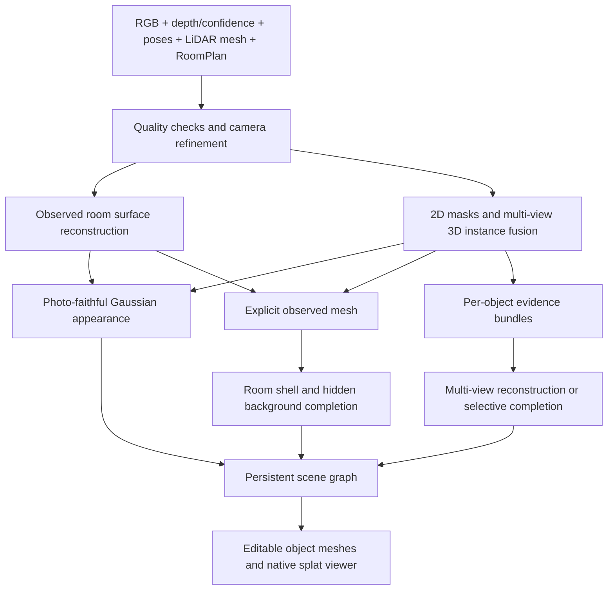

# Photorealistic, complete, object-segmented room reconstruction

Research date: October 17, 2026. This is a source-backed architecture investigation, not an implementation or benchmark. Recommendations are engineering judgments based on the linked first-party code, papers, documentation, and model terms. No models were run on ReSpace room captures, no cloud resources were provisioned, and no capture data was uploaded for this research.

## Decision

**Build a photo-conditioned scene with persistent object identities, reconstructed visible surfaces, and selectively generated hidden surfaces. Evaluate a Gaussian appearance layer alongside an editable textured mesh layer.** Keep the captured furniture's appearance; category-matched stock furniture does not meet this requirement.

The most useful first experiments are:

1. **Room reconstruction:** compare current Open3D/OpenMVS output with **DN-Splatter/AGS-Mesh** and a current **gsplat/Splatfacto** appearance baseline. DN-Splatter specifically addresses indoor smartphone RGB-D; gsplat is a flexible implementation foundation. Add **OMeGa** as the promising mesh-and-splat challenger, subject to reproduction and dependency checks. [DN-Splatter](https://github.com/maturk/dn-splatter), [gsplat](https://github.com/nerfstudio-project/gsplat), [OMeGa](https://github.com/Hao7un/OMeGa)
2. **Instance segmentation:** use **SAM 3/3.1**, or SAM 2 where its simpler licensing/deployment is preferable, then fuse masks across calibrated views with depth and visibility checks. **Open3DIS** and **MaskClustering** are useful references for the 3D association stage. [SAM 3](https://github.com/facebookresearch/sam3), [SAM 2](https://github.com/facebookresearch/sam2), [Open3DIS](https://github.com/VinAIResearch/Open3DIS), [MaskClustering](https://github.com/PKU-EPIC/MaskClustering)
3. **Complete actual furniture:** compare **SAM 3D Objects** for occluded scene objects against **Pixal3D's multi-view path** for objects with several usable views. Add **WorldSculpt** as the more ambitious scene-composition experiment because its released pipeline accepts RGB, instance masks, and 3D boxes. These are candidates, not a demonstrated winning combination. [SAM 3D Objects](https://github.com/facebookresearch/sam-3d-objects), [Pixal3D](https://github.com/TencentARC/Pixal3D), [WorldSculpt](https://github.com/AlayaLab/WorldSculpt)
4. **Delivery:** preserve a scene graph and separate object meshes for editing/export; evaluate **MetalSplatter** for a native iOS appearance viewer. A splat file alone is insufficient as the application's editable object database. [MetalSplatter](https://github.com/scier/MetalSplatter)

**Choose the winning stack on the same real rooms before rebuilding the production worker.** The lower-risk route is modular reconstruction plus per-object completion. The higher-upside route is WorldSculpt-style compositional reconstruction. A convincing whole-room generation demo is not evidence that every object remains faithful or selectable.

## What the requirement means

| Requirement | Acceptance meaning | Common false positive |
| --- | --- | --- |
| Photorealistic | Recognizable original upholstery, wood grain, artwork, clutter, silhouettes, and appearance across viewpoints | A plausible room rendered with attractive stock furniture |
| Complete | Room shell is continuous where appropriate; movable objects have usable backs/sides; newly exposed floor and wall exist | Filling every hole, including doorways or the gaps between chair legs |
| Segmentable | Persistent instance IDs map to selectable surfaces/assets across views and save/reopen | Labels such as “chair” with no distinction between four chairs |
| Editable, if needed | One object's transform can change without moving its neighbors or leaving its original appearance behind | Selecting some splats while shadows and original object fragments remain |
| Approximate dimensions | Visually credible proportions, orientation, contact, and relative scale | Discarding calibration and accepting furniture floating above the floor |

Selection/labeling is a smaller problem than moving/removing furniture. The proposed architecture supports both, but completion, background repair, and lighting become mandatory only for credible edits.

Unseen surfaces cannot be recovered uniquely from images that never observed them. The useful compromise is **preserve evidence where it exists and infer plausible missing parts elsewhere**. Generated chair backs may look appropriate without being the true chair back. This is a limitation of the observations, not a setting that higher-resolution meshing can fix.

## ReSpace's actual starting point

The current working tree already contains a stronger capture substrate than the earlier generic-furniture research assumed:

| Local evidence | Current behavior | Consequence |
| --- | --- | --- |
| [FrameEncoder.swift](../../ReSpace/Capture/FrameEncoder.swift) | High-quality local profile saves JPEGs up to a 2560-pixel edge, quality 0.9, scaled intrinsics, camera-to-scan transforms, timestamps, scene depth and confidence | Existing scans can be candidates; conversion and quality assessment come before a new capture system |
| [Worker README](../../services/reconstruction/README.md) | Up to 900 keyframes, nominal 0.5-second sampling, 2 GiB capture budget, final mesh and RoomPlan data | Frame count alone does not establish sharpness, useful baseline, or coverage |
| [pipeline.py](../../services/reconstruction/respace_reconstruction/pipeline.py) | 1.5 cm TSDF fusion, smoothing, small planar repairs, RoomPlan wall/floor filling, OpenMVS refinement/texturing | Useful baseline and geometric prior; no learned furniture completion or full instance pipeline |
| Same worker | Writes a COLMAP-format model using existing poses; does not run COLMAP feature matching/bundle adjustment | Current photo refinement is not evidence of pixel-accurate camera alignment |
| [ProcessedRoomScene.swift](../../ReSpace/Rendering/ProcessedRoomScene.swift) | Model I/O + SceneKit load a textured mesh | Mesh delivery fits the current viewer; splats require another rendering path |
| [Deployment notes](../../services/reconstruction/deploy/README.md) | Current documented server is an `e2-standard-4` CPU VM, 16 GB system RAM | CUDA pipelines require GPU workers or a hosted service; changing Python dependencies is insufficient |

These are source/document observations, not a live audit of the deployed VM or actual capture quality. Older documents recommending generic furniture were written for a different target. This report follows the new requirement to preserve the real room's appearance.

## Five viable pipeline families

| Pipeline | Appearance fidelity | Editable geometry/completeness | Engineering tradeoff | Verdict for ReSpace |
| --- | --- | --- | --- | --- |
| A. RGB-D fusion + photogrammetry + texture projection | Can preserve actual photos well where visible | Explicit mesh; hidden furniture still missing | Closest to current worker; transparent failure modes | Keep as baseline and fallback |
| B. Gaussian splatting + 3D instance labels | Strong candidate for photographed appearance | Selectable Gaussian groups; no automatic complete solid objects | Requires custom viewer and labeling; novel/back views expose gaps | Best appearance reference, insufficient alone |
| C. Surface-aware splats + mesh extraction + selective object completion | Combines observed appearance with explicit surfaces | Full objects and background require extra completion stages | More integration, but each stage can be evaluated independently | **Preferred architecture to prototype** |
| D. Direct compositional reconstruction/generation from multi-view observations | Promising photo-conditioned meshes | Separate inferred objects and approximate layout | Newer releases, input adapters, uncertain real-phone robustness | **Highest-upside challenger: WorldSculpt/Pixal3D** |
| E. Whole-world/panorama generation or hosted reconstruction | Fast external quality reference or plausible full room | Export/instance editability varies | Vendor access/terms, data format and fidelity need validation | Benchmark option, not assumed replacement |

This ranking is an inference for this product. There is no cross-paper metric that fairly ranks these methods on ReSpace's particular scans.

## Reconstruction models and libraries

### The practical shortlist

| Model/library | What official sources establish | ReSpace role and limitation |
| --- | --- | --- |
| **DN-Splatter + AGS-Mesh** | Depth/normal priors, indoor smartphone RGB-D processing, rendering and mesh extraction workflows | Best input-specific first reproduction. Repository pins older Nerfstudio/gsplat versions; reproduce in isolation before porting ideas. Apache-2.0 repository does not settle every model/dependency license. [Source](https://github.com/maturk/dn-splatter) |
| **gsplat / Splatfacto** | CUDA Gaussian rasterization and training examples; Splatfacto is a Nerfstudio method built on gsplat | General appearance baseline and likely long-term foundation. Add depth losses/instance association explicitly. **Splatfacto mesh export is officially unsupported**; surface-aware methods or a separate mesh pipeline are required. [gsplat](https://github.com/nerfstudio-project/gsplat), [Splatfacto](https://docs.nerf.studio/nerfology/methods/splat.html) |
| **OMeGa, WACV 2026** | Joint optimization of explicit mesh and mesh-bound 2D Gaussians; initial mesh input | Strong conceptual match for a shared geometry/appearance representation. Its example prepares a VFM point cloud/coarse mesh; adapting ReSpace's LiDAR mesh is a proposed experiment. Small research release; verify reproduction and dependencies. [Source](https://github.com/Hao7un/OMeGa) |
| **MILo, SIGGRAPH Asia 2025** | Mesh-in-the-loop surface reconstruction, indoor handling and exposure options; documented mesh extraction yields PLY with vertex colors | Strong mesh-quality comparison, with separate work needed to establish UV-textured delivery. Official implementation inherits restrictive Gaussian-Splatting terms. [Source](https://github.com/Anttwo/MILo) |
| **GaussianWrapping, ECCV 2026** | Released whole-scene meshing/texturing workflow with watertight reconstruction objective | Worth a thin-structure/mesh comparison; watertightness must not bridge real openings. Uses restricted Gaussian-Splatting lineage. [Source](https://github.com/diego1401/GaussianWrapping) |
| **COLMAP / PyCOLMAP + OpenMVS** | Known-camera reconstruction, sparse/dense reconstruction and image-based meshing/texturing | Test pose refinement and higher-detail photo-derived geometry, not just deforming the coarse fused mesh. Indoor blank walls/reflective objects remain difficult. [COLMAP known poses](https://colmap.github.io/faq.html#reconstruct-sparse-dense-model-from-known-camera-poses), [OpenMVS](https://github.com/cdcseacave/openMVS) |
| **Open3D / nvblox** | RGB-D volumetric fusion and mesh extraction | Geometric scaffolding, visibility tests, alignment, shell/collision mesh. Fusion cannot invent unseen upholstery or restore detail absent from depth. [Open3D](https://www.open3d.org/docs/release/tutorial/pipelines/rgbd_integration.html), [nvblox](https://github.com/nvidia-isaac/nvblox) |

**Implementation decision:** treat DN-Splatter as a reproducible experiment and reference for RGB-D losses; do not force its pinned environment into the existing worker or assume compatibility with gsplat main. Evaluate the current gsplat stack in a separate environment. Current main-branch notes advertise 2026 Gaussian-ID queries and LiDAR sensor models, not turnkey ARKit ingestion/fusion. These features must be pinned and tested rather than assumed present in the installed PyPI version. [DN-Splatter setup](https://github.com/maturk/dn-splatter), [gsplat release/development notes](https://github.com/nerfstudio-project/gsplat)

### Alternatives and why they are not the first bet

| Candidate | Useful capability | Reason for lower priority |
| --- | --- | --- |
| **2D Gaussian Splatting** | Surface-oriented representation and geometry extraction | Good reference baseline; visible surface reconstruction does not solve occluded completion. Original code terms need checking. [Source](https://github.com/hbb1/2d-gaussian-splatting) |
| **SuGaR** | Mesh extraction and mesh-bound Gaussian appearance/editing | Relevant hybrid design; newer joint methods deserve comparison, and original implementation licensing is restrictive. [Source](https://github.com/Anttwo/SuGaR) |
| **GOF / PGSR** | Gaussian-derived surfaces, geometry regularization | Useful research comparisons; not complete object-aware pipelines. [GOF](https://github.com/autonomousvision/gaussian-opacity-fields), [PGSR](https://github.com/zju3dv/PGSR) |
| **Neuralangelo / SDFStudio** | Neural implicit surface reconstruction and extraction | Useful mesh benchmark; more machinery before instance editing and mobile delivery. Not a hidden-surface completion guarantee. [Neuralangelo](https://github.com/NVlabs/neuralangelo), [SDFStudio](https://github.com/autonomousvision/sdfstudio) |
| **VGGT / MASt3R / DUSt3R** | Image-based camera/geometry estimation and initialization | Useful when ARKit poses are poor; these do not replace high-detail scene optimization, stable object IDs, or completion. Check weight terms separately; VGGT has a distinct commercial checkpoint. [VGGT](https://github.com/facebookresearch/vggt), [MASt3R](https://github.com/naver/mast3r), [DUSt3R](https://github.com/naver/dust3r) |
| **HunyuanWorld-Mirror / WorldMirror 2.0** | Feed-forward reconstruction with optional pose/intrinsics/depth priors; multi-representation outputs | Technically relevant multimodal initializer. Official licensing has geographic/use restrictions; not the default globally deployable stack. [Mirror](https://github.com/Tencent-Hunyuan/HunyuanWorld-Mirror), [World 2.0](https://github.com/Tencent-Hunyuan/HY-World-2.0) |
| **Apple SHARP** | Single-photo Gaussian prediction for nearby novel views | Not a multiview full-room reconstruction system. Model terms restrict use to noncommercial research and explicitly exclude product development. [Code](https://github.com/apple-aiml-research/ml-sharp), [model license](https://github.com/apple-aiml-research/ml-sharp/blob/main/LICENSE_MODEL) |
| **3DGRUT / NuRec** | Camera/sensor-aware Gaussian reconstruction; NVIDIA documents a pipeline combining poses, depth, nvblox mesh and neural appearance | Useful architecture reference, especially for rolling shutter. Broader robotics/OpenUSD stack and RTX-specific paths add complexity; USDZ can contain specialized neural payloads, not ordinary RealityKit-renderable surfaces. [3DGRUT](https://github.com/nv-tlabs/3dgrut), [robotics workflow](https://docs.nvidia.com/nurec/robotics/neural_reconstruction_stereo.html) |

For pose work, use current COLMAP capabilities rather than beginning a new dependency on standalone GLOMAP: its own repository says it has moved into COLMAP. [GLOMAP notice](https://github.com/colmap/glomap)

## Segmentation: masks must become persistent 3D instances

**SAM 3 and SAM 3D Objects solve different problems.** The former produces image/video masks and tracking; the latter generates 3D objects from image evidence. Neither should be treated as the whole room reconstruction pipeline. SAM 3's repository includes the March 2026 SAM 3.1 Object Multiplex update; model access and its custom SAM terms apply. SAM 2 remains an Apache-2.0 alternative. [SAM 3](https://github.com/facebookresearch/sam3), [SAM 2](https://github.com/facebookresearch/sam2), [SAM 3D Objects](https://github.com/facebookresearch/sam-3d-objects)

| Approach | Value | Limitation |
| --- | --- | --- |
| SAM 3/3.1, or SAM 2 + a detector | Prompted object masks and temporal propagation | Video track IDs can split/merge and do not identify the same object after arbitrary revisits |
| Open3DIS | Combines 2D-guided proposals and 3D proposals for open-vocabulary instances | Full research stack, not a one-call room API; useful reference for proposal fusion. [Source](https://github.com/VinAIResearch/Open3DIS) |
| MaskClustering | Multi-view mask association/clustering with visibility information | Attractive geometry-aware reference; mask and pose errors still propagate. No root license was verified; permission must be established before incorporating code. [Source](https://github.com/PKU-EPIC/MaskClustering) |
| OpenMask3D | Open-vocabulary features on 3D instance proposals | Useful object retrieval/labeling; depends on the quality and existence of instance proposals. [Source](https://github.com/OpenMask3D/openmask3d) |
| ConceptGraphs | RGB-D instance mapping and semantic scene graph | Useful identity/relationship architecture; not detailed asset completion. [Source](https://github.com/concept-graphs/concept-graphs) |
| Gaussian Grouping / SAGA / Click-Gaussian | Lifting masks or features into splats for 3D selection | Good research references; editability is not complete object geometry, and submodule licenses require inspection. Click-Gaussian code/license availability was not established from its project page. [Gaussian Grouping](https://github.com/lkeab/gaussian-grouping), [SAGA](https://github.com/Jumpat/SegAnyGAussians), [Click-Gaussian paper/project](https://seokhunchoi.github.io/Click-Gaussian/) |
| LangSplat / Feature 3DGS | Language/feature fields for querying regions | “Find the sofa” is not the same as an independent sofa asset with a complete underside. [LangSplat](https://github.com/minghanqin/LangSplat), [Feature 3DGS](https://github.com/ShijieZhou-UCLA/feature-3dgs) |

Recommended association procedure, to be implemented and tested:

1. Mask selected sharp keyframes and propagate where appropriate. Keep image mask confidence and provenance.
2. Unproject confident depth pixels through each image's actual calibration into scan coordinates. Downweight uncertain depth/mask boundaries and reject inconsistent observations, occluded/background hits, invalid depths, and excessive depth disagreement. Preserve supported thin legs and small objects.
3. Associate candidates using visible 3D overlap, reprojection agreement, appearance, category, and temporal evidence. RoomPlan bounds are useful priors, not exact furniture surfaces. Avoid merging objects merely because their boxes touch.
4. Fuse observations into persistent `instance_id` records. Support splitting/merging a mistaken instance and preserve IDs through revision changes.
5. Label mesh faces using visible multi-view votes; mark ambiguous regions unknown. For splats, use rendered contribution/visibility rather than assigning every Gaussian whose center falls inside a 2D mask. Large Gaussians can span object boundaries.
6. After completion or remeshing, regenerate surface ownership from the instance asset, then verify against source-view masks. Do not preserve stale face indices after topology changes. Gaussian densification, pruning, sorting and LOD similarly require persistent IDs or explicit remaps; array indices are revision-local.

Use a small manual correction set as ground truth. An automatic mask for “chair” that merges the seat, table, and another chair will corrupt every subsequent stage. Newer segmentation papers with unreleased code are not prerequisites for the first prototype.

## Completion: preserve real objects and infer only what is missing

| Candidate | Supported evidence/input | Recommended use | Main constraint |
| --- | --- | --- | --- |
| **Pixal3D multi-view** | Released September 2026 path takes multiple views with camera-to-world matrices/FOV; separate multi-view weights | First multi-photo object experiment for furniture observed from several directions; PBR mesh output | Per-object conditioning and camera normalization needed; does not automatically accept arbitrary ARKit crops/intrinsics. [Code and input format](https://github.com/TencentARC/Pixal3D) |
| **SAM 3D Objects** | Scene image plus mask; inferred shape, texture and layout | First scene-aware completion experiment for partly occluded furniture | Single-image prior can disagree with other real views. Official setup requires Linux/NVIDIA ≥32 GB VRAM and gated checkpoint access. [Repository](https://github.com/facebookresearch/sam-3d-objects), [setup](https://github.com/facebookresearch/sam-3d-objects/blob/main/doc/setup.md) |
| **WorldSculpt** | RGB views, instance masks, 3D boxes; fine-tuned object prior for occluded multi-view inputs | Strongest direct compositional-scene challenger found; avoids asking isolated-object code to solve all scene occlusion | Recent September 2026 release; phone-room behavior/resource demand must be reproduced. Dependency notice includes gated DINOv3 weights. [Source](https://github.com/AlayaLab/WorldSculpt), [dependency terms](https://github.com/AlayaLab/WorldSculpt/blob/main/THIRD_PARTY_LICENSES.md) |
| **TRELLIS.2** | Single-image object generation with detailed geometry and PBR appearance | Strong complete-object baseline/fallback | Single-image path is not calibrated multiview reconstruction. Linux/NVIDIA ≥24 GB documented; top-level MIT does not clear dependencies. [Source](https://github.com/microsoft/TRELLIS.2) |
| **Original TRELLIS** | Includes experimental multi-image conditioning | Alternate multiple-photo experiment | Official warning that tuning-free multi-image conditioning is imperfect; do not confuse it with TRELLIS.2 capabilities. [Source](https://github.com/microsoft/TRELLIS) |
| **InSpace, ECCV 2026** | Single 360° image to room structure and separately textured furniture | Useful full-room plausibility/layout comparison | Panorama is not a substitute for all registered photos; README limits current pipeline to research because of dependencies. [Source](https://github.com/naver/inspace) |
| **MIDI / RecGen / PartCrafter** | Multi-instance single-image scene generation; RGB-D object reconstruction; part-compositional object generation, respectively | Relevant research comparisons for clutter, geometry priors or object parts | Different scopes and restrictive dependencies/terms; RecGen explicitly limits use to noncommercial purposes. None is assumed production-ready for whole-room phone scans. [MIDI](https://github.com/VAST-AI-Research/MIDI-3D), [RecGen](https://github.com/TRI-ML/recgen), [PartCrafter](https://github.com/wgsxm/PartCrafter) |
| **Hunyuan3D / TripoSG / TripoSR** | Image-conditioned object generation; TripoSG primarily generates shape and needs separate texturing | Secondary fallback benchmark | Hunyuan3D 2.1's Community license excludes EU/UK/South Korea, including outputs; it is not Pixal3D's MIT grant. View fidelity and materials need evaluation. [Hunyuan3D 2.1](https://github.com/Tencent-Hunyuan/Hunyuan3D-2.1), [terms](https://github.com/Tencent-Hunyuan/Hunyuan3D-2.1/blob/main/LICENSE), [TripoSG](https://github.com/VAST-AI-Research/TripoSG), [TripoSR](https://github.com/VAST-AI-Research/TripoSR) |

### How to make generation preserve the real furniture

The following is the proposed integration, not a stock capability of all listed models:

- Build one evidence bundle per instance: masked full images, crops, actual intrinsics, poses, visible surface samples, approximate bounds, and support plane. Select views for complementary coverage, not just count.
- Reconstruct observed geometry first when sufficient multi-view evidence exists. Invoke completion for partial objects, not as an unconditional room-wide replacement.
- For Pixal3D, convert into its object/world camera convention and honor the canonical first-view requirement. Its public multiview schema uses FOV; arbitrary principal point, crop, or lens distortion is not represented by copying an ARKit matrix. Rectify/reframe to supported cameras or adapt the loader. Cropping/resizing must transform intrinsics consistently.
- Use real additional views to reject wrong geometry, color, silhouette or orientation. Do not turn several guesses from one photograph into independent observational evidence.
- Align generated assets to visible depth/masks, approximate extent, floor/contact constraints and their object coordinate frames. Do not force every object into a category box's exact shape.
- Project or optimize appearance from real photos over visible surfaces; use generated appearance for unsupported parts. A final “polish” pass must not overwrite a recognizable chair pattern with invented fabric.
- Retain several candidates or a low-confidence completion state when the evidence does not determine the shape. Allow a short object-specific rescan when that would help more than additional generation.

### Furniture completion does not complete the room behind it

Moving a sofa exposes both the sofa's back and the wall/floor it hid. Reconstruct these as separate problems:

1. Segment furniture out of the background reconstruction so its original geometry/splats can be suppressed completely.
2. Complete walls/floor/ceiling using the room's measured planes/polygons while preserving openings and discontinuities.
3. Recover background appearance from other observed views first. Where no evidence exists, infer materials or perform surface-aware inpainting.
4. If generating novel views for missing areas, enforce known geometry/depth and validate consistency across several views before fitting them. A single inpainted image may introduce texture and geometry contradictions.
5. Track observed versus inferred surfaces and textures in the asset metadata. Keeping that distinction internally prevents later optimization from treating invented content as ground truth.

Even a perfect object mask does not remove a baked shadow, reflection, or indirect light contribution from the floor. Standard captured textures/splats encode appearance under the capture lighting. Credible furniture relocation may require approximate shadow cleanup and new lighting; full inverse rendering is a separate research objective. Merely adding a PBR material or moving spherical-harmonic coefficients does not solve this.

Two concrete background-completion references are worth reproducing if editing is required. **Inpaint360GS (WACV 2026)** supplies object-aware Gaussian removal and depth-guided inpainting from virtual views; it is not a clean background-mesh exporter, and its submodules need separate license checks. **GenRC** completes indoor meshes from sparse RGB-D through panoramic generation, but does not provide the persistent object graph by itself. Both should be compared with the simpler measured-plane plus real-photo texture baseline. [Inpaint360GS](https://github.com/dfki-av/Inpaint360GS), [GenRC](https://github.com/minfenli/GenRC)

## Proposed architecture



The application owns instance IDs and transforms. Meshes and splats are versioned representations of those instances, not the source of identity. Suggested output contract:

```text
scene.json                 # coordinate convention, capture/revision, object graph
room_shell.*               # explicit room surfaces with real openings
objects/<instance_id>.*    # object-local textured geometry + material assets
appearance.*               # optional room/object Gaussian representation
surface_ownership.*        # face/splat-to-instance mapping for this exact revision
provenance.json            # source observations, inferred regions, confidence
quality.json               # visual/geometry/instance/mobile metrics and failures
```

Use GLB or USD assets according to the chosen viewer/import path; verify texture/material round trips. Keep JSON metadata external if an exporter strips custom properties. A `.ply` extension is ambiguous: a point cloud, triangle mesh and Gaussian model can all use it with different schemas. Converting file names or exporting a collider does not transfer the Gaussian appearance into an ordinary textured mesh.

### Rendering options

**Mesh-first:** easiest continuation of the current native viewer and export workflow. If photo-textured meshes meet the visual target, ship that simpler representation and retain splats as a reference/optional mode.

**Hybrid:** retain Gaussian appearance for the untouched captured scene and use complete object meshes for edits. This needs explicit instance ownership, depth compositing, suppression of original object splats, and consistent color/lighting. A switch from a splat sofa to a mesh sofa can be visible; measure that transition rather than assuming it is seamless.

**Object-level splats:** possible for selectable/transformed Gaussian groups, but hidden geometry and baked illumination still need solving. Transform centers and covariance/orientation together; for rotations, view-dependent appearance must also be transformed/re-evaluated consistently. Splats do not automatically become collision surfaces.

[MetalSplatter](https://github.com/scier/MetalSplatter) is MIT Swift/Metal with iOS/macOS/visionOS support and PLY/SPZ/splat loading. It is a renderer, not a native RealityKit mesh importer or reconstruction trainer. Profile real iPhones for sorting cost, memory, Gaussian count, transparency, and mixed mesh/splat depth. [DeformableMetalSplatter](https://github.com/yunjinli/DeformableMetalSplatter) is an additional interaction reference. For web review, [Spark](https://github.com/sparkjsdev/spark) and [SuperSplat](https://github.com/playcanvas/supersplat) are useful tooling candidates.

## Commercial and desktop alternatives

| Option | Verified capability | How to use it in the evaluation |
| --- | --- | --- |
| **Polycam Reconstruction API** | Approved Enterprise integrations can upload session archives and request `photo` or `splat` reconstruction; splat mode requires Polycam-specific poses/intrinsics metadata | Relevant build-vs-buy benchmark using an adapter. Limited availability, prepaid credits and workspace limits apply. It is not a general arbitrary RGB-D ingestion API; source archive schema must be agreed and tested. [Reconstruction API](https://poly.cam/docs/api/reconstruction) |
| **Polycam Content API** | Downloads existing artifacts and converts available mesh data to additional formats | Export availability does not prove splat-to-detailed-mesh conversion or automatic object completion. [Content API](https://poly.cam/docs/api) |
| **RealityScan Desktop** | Photo/LiDAR registration, meshing, texturing and CLI automation | Strong conventional photogrammetry quality reference. Verify supported LiDAR import format: an iPhone mesh is not automatically equivalent to a supported scanner acquisition. Windows/CUDA requirements differ from the current server. [LiDAR import](https://rshelp.capturingreality.com/en-US/tutorials/importlaser.htm), [CLI](https://rshelp.capturingreality.com/en-US/appbasics/allcommands.htm), [hardware](https://dev.epicgames.com/documentation/realityscan/hardware-and-software-requirements) |
| **Scaniverse / Niantic Spatial** | Platform generates splats and meshes from supported capture workflows; export options include common mesh/splat formats | Useful external quality bar. Establish BYOD access and capture-format compatibility before assuming ReSpace files can be submitted. [Quickstart](https://www.nianticspatial.com/docs/scaniverse/quickstart/), [capture/BYOD](https://www.nianticspatial.com/products/capture), [exports](https://nianticspatial.com/docs/scaniverse/advanced_tools/) |
| **World Labs Marble / World API** | World generation from text/images/video and multi-image prompts, with downstream assets | Evaluate when plausible completion matters more than faithful reconstruction. Public multi-image examples use azimuth conditioning; do not assume a calibrated LiDAR registration contract or instance assets. [API announcement](https://www.worldlabs.ai/blog/announcing-the-world-api), [API docs](https://docs.worldlabs.ai/api) |
| **Brush** | Cross-platform Gaussian training/viewing from COLMAP/Nerfstudio formats, masking and CLI; WebGPU/Burn | Accessible desktop appearance benchmark, including macOS, without adopting a full CUDA research stack. Does not establish completion or automatic semantic instances. [Source](https://github.com/ArthurBrussee/brush) |
| **LichtFeld Studio** | Training, inspection, Gaussian selection/transforms, exports and automation | Useful manual QA workstation; core GPL-3.0 and dependencies need review if integrating/distributing code. Editing subsets is not completion. [Source](https://github.com/MrNeRF/LichtFeld-Studio), [license](https://github.com/MrNeRF/LichtFeld-Studio/blob/master/LICENSE) |

No vendor was contacted and no paid service was used. Product pages establish supported interfaces, not fidelity on these room scans. Quotes and current pricing should be obtained only after the benchmark identifies a useful service.

## Capture and preprocessing changes with the highest expected value

These are proposed improvements, not claims of deficiencies proven on a particular room:

- **Coverage guidance over duration:** retain a whole-room pass, then closer views around important furniture from different heights. A three-minute minimum is not proof that the back of a chair or the floor behind it was observed.
- **Quality and diversity selection:** reject blur/poor tracking, retain useful angular baseline and complementary surfaces, and avoid spending a frame budget on repeated views from the same position.
- **Camera alignment:** use ARKit poses as valuable initialization/priors; validate reprojection and depth alignment, then compare fixed versus refined poses. Keep outputs aligned to the original room frame using depth/structure constraints.
- **Calibration discipline:** preserve image orientation, dimensions, intrinsic scaling, distortion/rectification status, depth registration, timestamps, and coordinate conversions. Test reprojection overlays before optimizing a model.
- **Photometric evidence:** record exposure/white-balance information when the capture API supplies it and retain high-resolution originals where practical. The current encoder does not serialize those fields. Evaluate brightness/exposure correction before assuming more triangles will fix seams.
- **Thin/reflective surfaces:** downweight unreliable LiDAR instead of forcing images to match it. Keep confidence-weighted depth constraints; seek additional RGB coverage for chair legs, lamps, glass and mirrors.
- **Static scene:** avoid people, moving doors/furniture and changing lights during capture. Distractor masks and outlier rejection can mitigate motion but cannot guarantee a single consistent room from changing content.

Research on egocentric capture directly supports treating camera timing, calibration, rolling shutter and photometry as first-class problems; its Aria-specific implementation is not a drop-in iPhone capture pipeline. [Meta egocentric splats](https://github.com/facebookresearch/egocentric_splats)

Approximate dimensions let us relax strict metric penalties in favor of visual quality. They do not remove the need for consistent cameras, object proportions, support/contact and topology.

## Hardware, packaging, and licensing gates

### Compute plan

Keep the current API/job persistence and immutable capture store; dispatch experiments to isolated GPU environments. Reuse resumable upload, checksums, versioned results and stage failure recovery. The present CPU deployment remains useful for orchestration and fallbacks.

| Workload | Sourced requirement or planning assumption |
| --- | --- |
| SAM 3D Objects | Official setup: Linux 64-bit and NVIDIA GPU with at least 32 GB VRAM. Gated checkpoints. [Setup](https://github.com/facebookresearch/sam-3d-objects/blob/main/doc/setup.md) |
| TRELLIS.2 | Official README: Linux/NVIDIA, at least 24 GB GPU memory; published speed figures use H100. They do not establish room-processing time or performance on cheaper GPUs. [Source](https://github.com/microsoft/TRELLIS.2) |
| Pixal3D / WorldSculpt | TRELLIS.2-based environments, CUDA extensions and separate weights; low-memory options exist for Pixal3D. Actual peak use on room-derived crops is unmeasured. [Pixal3D](https://github.com/TencentARC/Pixal3D), [WorldSculpt](https://github.com/AlayaLab/WorldSculpt) |
| Initial shared evaluation machine | **Planning estimate:** one 48 GB NVIDIA GPU with adequate host RAM/disk is a practical starting point for sequential experiments. Not a promise that every configuration fits or a sourced universal requirement. A 24 GB machine excludes the documented SAM 3D baseline. |
| Mobile | Train/process remotely; load optimized inference assets on iPhone. Real-device memory, loading and frame-rate measurements determine budgets. |

Measure GPU-hours and failure/retry rates per room/object. Do not extrapolate a single-object H100 demo into a full room latency claim. Do not sum sequential stage VRAM requirements as if all models must stay loaded simultaneously.

### Important dependency distinctions

Repository code, checkpoint weights, third-party modules, hosted-service terms, and generated outputs can have different conditions. A permissive top-level repository badge alone is insufficient.

- gsplat, Nerfstudio and DN-Splatter have Apache-2.0 code paths; Meta SAM 3 and SAM 3D Objects use custom SAM terms and gated models, whereas SAM 2 is Apache-2.0. Check the exact revision and models selected. [gsplat](https://github.com/nerfstudio-project/gsplat), [Nerfstudio license](https://github.com/nerfstudio-project/nerfstudio/blob/main/LICENSE), [SAM terms](https://github.com/facebookresearch/sam3/blob/main/LICENSE), [SAM 3D terms](https://github.com/facebookresearch/sam-3d-objects/blob/main/LICENSE)
- Pixal3D's NOTICE explicitly includes its released code/parameters/weights under MIT; third-party components retain their terms. TRELLIS.2 likewise has separate dependency obligations. [Pixal3D NOTICE](https://github.com/TencentARC/Pixal3D/blob/master/NOTICE), [TRELLIS.2](https://github.com/microsoft/TRELLIS.2)
- **nvdiffrast and nvdiffrec are material traps:** the reviewed NVIDIA licenses' use limitations permit noncommercial research/evaluation for others. They are used by several otherwise permissively labeled generation stacks. Identify the exact installed revisions and executed export/render paths; replace/obtain permission for restricted dependencies before commercial deployment. [nvdiffrast license, section 3.3](https://github.com/NVlabs/nvdiffrast/blob/main/LICENSE.txt), [nvdiffrec license](https://github.com/NVlabs/nvdiffrec/blob/main/LICENSE.txt)
- Original INRIA Gaussian-Splatting and implementations inheriting its terms require separate commercial consideration. A research comparison can still be useful without making that repository the production foundation. [Original license](https://github.com/graphdeco-inria/gaussian-splatting/blob/main/LICENSE.md)
- SHARP's model license expressly excludes product development. InSpace's README warns about research-only dependency constraints. These should not silently enter a product prototype as unrestricted defaults. [SHARP model terms](https://github.com/apple-aiml-research/ml-sharp/blob/main/LICENSE_MODEL), [InSpace](https://github.com/naver/inspace)

This is a record of observed terms and an implementation gate, not a blanket legal clearance of any assembled stack.

## Evaluation before committing to a rebuild

### Small benchmark with decisive comparisons

Use at least three real captures: a relatively simple room, a cluttered room with similar adjacent chairs, and a room containing difficult materials/thin furniture. Reserve spatially separated real views before any fitting/selection that could leak them into training. Adjacent video frames alone are an overly easy held-out test.

| Experiment | Question answered | Output |
| --- | --- | --- |
| E0: current worker | What is the actual starting quality and failure pattern? | Mesh, textures, source-view overlays, hole map |
| E1: gsplat/Splatfacto | Can the retained photos deliver the desired appearance? | Held-out renders and mobile candidate splat |
| E2: DN-Splatter/AGS-Mesh; OMeGa challenger | Does depth/surface-aware optimization improve usable mesh geometry? | Mesh and appearance compared on identical views |
| E3: mask fusion | Can similar adjacent objects stay distinct in 3D? | Persistent instances, projected masks, manual corrections |
| E4: SAM 3D Objects vs Pixal3D multi-view | Which better preserves actual furniture while completing it? | Same object evidence, candidate meshes, all-view validation |
| E5: WorldSculpt | Does a compositional model beat the modular assembly? | Same instance evidence/boxes, per-object meshes and full scene |
| E6: edited room | Does moving/removing furniture reveal ghosts, holes or incompatible lighting? | Hide/move/rotate tests and newly exposed background |
| E7: native delivery | Can the result actually ship on the target phone? | Verified assets, stable picking, peak memory, load time and FPS |

Run E1 before investing heavily in completion: if the photos are blurred or poorly registered, no downstream library choice alone establishes faithful detail. Run E4 on several objects before processing every object in a room.

### What to measure

- **Appearance:** blind comparison against held-out real photos; PSNR/SSIM/LPIPS as supporting metrics. Check texture patterns, object silhouette and difficult views separately; image scores alone do not establish complete geometry.
- **Geometry:** depth residuals on confident observations, visible surface coverage, floor contact, self-intersections and topology. “Watertight” is not enough and may be inappropriate for the whole room.
- **Identity:** instance precision/recall or mask IoU against a manually labeled subset; split/merge counts, repeated-object identity, small objects, and consistency after save/reopen.
- **Completion:** visible-part fidelity, plausible hidden shape and appearance, unsupported-area fraction, and candidate failure rate. Hidden truth needs additional capture or physical inspection, not a reference invented by the same model.
- **Editing:** no original furniture remnants; plausible exposed floor/wall; complete new object views; transforms affect only the chosen instance; shadows/reflections assessed explicitly.
- **Operations:** GPU/CPU time, peak RAM/VRAM, output size, reprocessing determinism, crash/retry recovery and downloaded asset integrity.
- **Mobile:** real-device startup and interaction on an agreed target phone. Start with a proposed ≥30 FPS interaction target and derive mesh/Gaussian/texture budgets from measurement; this target is not an achieved result.

### Commit criteria and next implementation boundary

Adopt the simplest representation that passes the appearance and object tests. If textured meshes suffice, a splat layer can remain optional. If splats substantially improve fidelity, keep explicit meshes for editing/picking and budget the hybrid renderer deliberately.

The first implementation should be an **offline capture adapter + reproducible benchmark runner**, not a replacement capture app or a newly provisioned production GPU server. It should export the existing immutable capture into each candidate's supported camera/depth/mask format, pin revisions and weights, record commands and resources, and produce comparable renders and assets. Then implement the winning stages behind the existing job API.

The central decision is settled at the architecture level: use the real photos as the source of appearance, LiDAR/RoomPlan as geometric priors, persistent 3D instances as the editing contract, and generative models only where observations cannot supply completeness. Which specific model wins remains an empirical question for ReSpace's scans.
