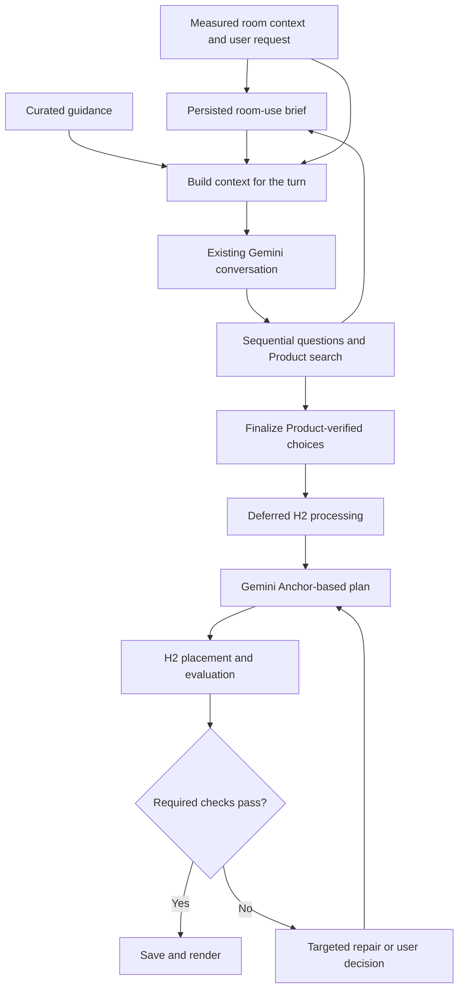

# Room layout research and Gemini awareness: side-chat summary

## Status, scope and authority

- **Purpose:** preserve the research, architectural alternatives, recommendations, examples, limitations and implementation plan developed in this side conversation.
- **User requests covered:** thoroughly research good room layouts, feng shui and occupant/personality differences; then propose a detailed architecture for adding that knowledge to the Gemini conversation and planning workflow; finally save the side-chat findings as Markdown.
- **Status:** research summary and architectural proposal. The user requested exploration and documentation; the proposed architecture has not been adopted or implemented by this conversation.
- **Governing specification:** [SPEC.md](../SPEC.md). This summary does not override it or introduce approved product requirements.
- **Vocabulary:** [CONTEXT.md](../CONTEXT.md) defines Objects, Items, Additions, Anchors, Room snapshots, Product-verified choices and other implementation terms.
- **Historical context:** the architectural discussion originally inspected a root-level `h3spec.md` and an earlier `SPEC.md`. The repository has since consolidated its specification; that H3 document is now [specs/h3spec.md](h3spec.md), a historical input. Earlier statements about missing backend implementation, open question numbers and conflicting draft sections describe that inspection, not the repository's current implementation state.
- **Scope of this summary:** this side conversation only. Inherited parent-thread grilling is included only where it supplied context for the architecture discussion, not as a continuation of that interview.

### How to read the evidence

- **Source finding:** a result or method reported by a linked paper or official guide. It establishes what that source reports, within its study conditions.
- **Professional guidance:** practical design guidance or standards; applicability must be checked before treating it as mandatory.
- **Proposal/inference:** our suggested application to ReSpace. It is not a research-validated outcome or an approved requirement.
- **Historical project assumption:** behavior read from the draft during the discussion. Reconcile it with the governing specification before implementation.

This was a broad research investigation, not a registered systematic review. Primary papers, author project pages, official guidance and publisher material were prioritized. Full paid books were not read. Research implementations were not run, and proposed defaults were not validated in occupied rooms.

## 1. Main conclusions

1. **Build around activities, physical needs and demonstrated preferences.** Ask what people actually do in a room, how many people use it and which trade-offs matter to them.
2. **Measure usability beyond collisions.** Furniture needs operating space, human access, activity space and connected circulation, in addition to a footprint.
3. **Keep feasibility separate from preference.** An attractive arrangement cannot compensate for a blocked required route. Aesthetic guidance generally remains adjustable.
4. **Use personality cautiously.** The evidence does not support a reliable universal personality-type-to-layout formula. Direct choices are more actionable than assigning a type.
5. **Treat feng shui as optional cultural/design preferences with calibrated explanations.** Some spatial ideas are useful to explore; broad claims about qi, prosperity or health were not established by the reviewed evidence.
6. **Preserve user agency.** Meaningful participation is supported by workplace experiments, although transfer to this app still needs evaluation.
7. **Give Gemini relevant knowledge and measured feedback.** A compact guidance library, current Room-use priorities and H2 findings can improve the existing agent loop.
8. **Start with one conversation and a small module.** A new agent, vector database or separately deployed service is unnecessary for the proposed initial curated knowledge set.
9. **Evaluate actual use as well as renders.** Visual preference, geometric feasibility and long-term satisfaction are different outcomes.

## 2. Research directly relevant to computational room layout

### 2.1 Function2Scene: functional specifications and iterative evaluation

**Source finding:** *Function2Scene: 3D Indoor Scene Layout from Functional Specifications* (2026) translates descriptions of occupants and activities into design constraints, then uses tool-assisted evaluation and repair. Its 17 criteria span spatial, ergonomic, activity and environmental considerations. Across 30 design cases, its results were preferred in 94.3% of the reported pairwise comparisons. The evaluation concerns rendered proposals; it is not a 94.3% real-home success rate. The project also reports that iterative refinement without useful evaluation tools performed poorly.

**Application proposed:** give Gemini concrete spatial feedback rather than repeatedly asking it to reconsider a plan. Borrow the functional-brief and check/repair approach. Some checks in the paper use model judgments; distinguish those from measured geometry. Preserve actual room geometry and real Product dimensions rather than copying research freedoms to resize a scene.

Sources: [paper](https://arxiv.org/abs/2605.30819), [project and evaluation](https://function2scene.github.io/).

### 2.2 Interactive Furniture Layout Using Interior Design Guidelines

**Source finding:** Merrell and colleagues (2011) encode interior-design guidance in a computational layout model, including clearance, circulation, conversation and focal relationships. Eighteen participants arranged five rooms; professional designers preferred assisted results in four configurations.

**Application proposed:** express layout principles as inspectable objectives and compare plausible arrangements. The small design-preference study does not guarantee comfort or improved life outcomes for every occupant.

Source: [author project page](https://graphics.stanford.edu/projects/furniture/).

### 2.3 LayoutEnhancer

**Source finding:** *LayoutEnhancer* adds ergonomic considerations such as reach, visibility, lighting, glare and access to layout generation. Its premise is that learning plausible arrangements from existing scenes does not automatically ensure usability.

**Application proposed:** evaluate an occupant performing an activity: approaching a chair, reaching a surface, seeing the intended target and leaving the position. Use explicit activity checks alongside learned or model-generated aesthetic judgments.

Sources: [paper](https://arxiv.org/abs/2202.00185), [author PDF](https://paulguerrero.net/papers/LayoutEnhancer.pdf).

### 2.4 Activity-centric Scene Synthesis

**Source finding:** Fisher and colleagues represent human activities and the object relationships supporting them in scene synthesis.

**Application proposed:** begin with needs such as two people eating, several hours of desk work or four people conversing, then identify suitable furnishings and relationships. A couch and beanbags provide seating but may serve those activities differently.

Source: [author project page](https://graphics.stanford.edu/~mdfisher/actSynth.html).

### 2.5 MIME: Human-Aware 3D Scene Generation

**Source finding:** MIME incorporates human motion and contact information in scene generation.

**Application proposed:** account for walking, approach, sitting and lying-down space. The initial product can adopt these concepts without implementing a motion-capture system or reproducing the entire research pipeline.

Source: [paper](https://arxiv.org/abs/2212.04360).

### 2.6 Additional technical leads

- [I-Design](https://arxiv.org/abs/2404.02838): natural-language design, spatial relationships and scene generation; relevant to semantic planning before metric placement.
- [Sequential Line Search](https://koyama.xyz/project/sequential_line_search/): preference-guided visual design optimization; a possible later reference for interactive comparisons.

These are references for further examination, not selected dependencies. No implementation, compatibility or licensing audit was performed.

## 3. What the layout should represent

The following is a proposed synthesis of computational research and professional guidance.

### 3.1 Several different kinds of space

| Space | Example | Implication |
|---|---|---|
| Physical footprint | Sofa body | Collision and room containment |
| Operating space | Drawer opening, reclining seat, extended sofa bed | Check relevant states of use |
| Human access space | Approaching and sitting at a chair | Preserve a usable approach |
| Activity space | Working at a desk or moving around a dining table | Evaluate the requested activity |
| Circulation space | Routes between entrances and destinations | Verify connectivity and relevant width |
| Service/access clearance | Access to a radiator, vent or equipment | Apply supported requirements where relevant |

**Professional guidance:** the publisher excerpt of *Human Dimension & Interior Space* explains that dining clearances must account for the chair's changing position and a person moving behind it. A tucked-in chair is only one use state. The book is a historical anthropometric reference; numerical defaults need contemporary applicability checks. [Publisher and excerpt](https://penguinrandomhousesecondaryeducation.com/book/?isbn=9780823072712).

**Product implication:** verified width, depth and height are necessary, but some categories require operating dimensions or an explicit unresolved check. Never silently treat a category estimate as a verified Product measurement.

### 3.2 Relationships between activities

Proposed relationships include:

- Dining seats must be usable at their table.
- Conversation seats should support the desired interaction.
- Screen use needs suitable orientation and sightlines.
- Frequently used destinations need convenient routes.
- Simultaneous quiet and noisy activities may need separation.
- Storage should be accessible near its intended use.

These can conflict. A television-focused arrangement may reduce conversational convenience; a larger table may consume everyday circulation space. Make the consequence visible when comparing designs.

### 3.3 Environmental conditions and unknowns

**Professional guidance:** OSHA recommends orienting computer screens at right angles to windows to help control glare and reflections, alongside appropriate lighting. Placing every desk directly facing a window is therefore an unreliable default. [OSHA workstation environment](https://www.osha.gov/etools/computer-workstations/workstation-environment).

**Source finding:** expert light-exposure recommendations distinguish daytime, evening and sleep periods. [Brown et al., 2022](https://journals.plos.org/plosbiology/article?id=10.1371/journal.pbio.3001571).

**Application proposed:** use room orientation, shading, user schedule and available measurements when relevant. A static scan does not establish year-round daylight, actual glare, acoustics, thermal comfort or the occupant's sensory experience. Mark missing information instead of claiming it was measured.

### 3.4 Accessibility and sensory preferences

**Professional guidance:** [PAS 6463: Design for the Mind](https://www.bsigroup.com/en-GB/insights-and-media/insights/brochures/pas-6463-design-for-the-mind-neurodiversity-and-the-built-environment/) addresses sensory aspects of layout, lighting, acoustics and other environmental conditions. Ask about individual needs; do not diagnose users or assume one layout suits everyone with a particular label.

**Standards example:** the US Access Board generally specifies 36 inches, published as 915 mm, for accessible walking surfaces, with exceptions and additional requirements. A generic 900 mm aisle does not establish ADA compliance. Standards must be selected for the relevant jurisdiction, building and use; a scan alone cannot certify compliance. [Accessible routes](https://www.access-board.gov/ada/guides/chapter-4-accessible-routes/).

## 4. Personality, preferences and room-use priorities

### 4.1 Findings and limitations

| Research | What it supports | What it does not establish |
|---|---|---|
| Gosling et al., *A Room with a Cue* | Rooms contain identity and behavioral cues; some personality judgments show accuracy, varying by trait/context | An ideal layout for each personality or a causal effect of layout on personality |
| Pohlmann et al., 2025 | Direct interactive furnishing can reveal preferences differently from passive image judgments | A universal personality-to-style formula |
| Study-room preference research, 2025 | Some questionnaire associations between personality and environmental preferences | Improved real-world outcomes from prescribing those features |

Sources: [Gosling author PDF](https://gosling.psy.utexas.edu/wp-content/uploads/2014/09/JPSP02-Roomwithacue.pdf), [Pohlmann et al.](https://www.nature.com/articles/s41598-025-23543-5), [study-room preferences](https://www.sciencedirect.com/science/article/pii/S0001691825005815).

The Pohlmann study involved 196 participants furnishing a virtual room. It found a small angular-furniture preference and no significant association between Big Five traits and the measured form/style preferences. Only 100 participants had complete personality data. Restricted furniture choices and interface ordering limit generalization. The study-room questionnaire involved 216 respondents and reported associations; this does not establish causation.

**Recommendation:** use explicit Room-use priorities and demonstrated choices. Do not infer personality from a scan, a messy room, rented furniture or limited possessions. Treat “cozy” and “studious” as independent preferences that can coexist.

### 4.2 Proposed room-use questions

| Dimension | Example | Decision affected |
|---|---|---|
| Main activities | What do you do here most often? | Space and furnishing priorities |
| Occupancy | How many people normally use it, and when hosting? | Everyday versus occasional capacity |
| Interaction | Mostly conversation, watching, working or a mix? | Orientation and focal relationships |
| Privacy | Do you like seeing the entrance from your seat? | Placement and sightlines |
| Sensory preferences | What bothers you: glare, noise or visual busyness? | Environmental and storage choices |
| Physical comfort | Are low seats comfortable for everyone using the room? | Product suitability |
| Storage/display | What should remain visible or be put away? | Open versus closed storage |
| Adaptability | Are you willing to rearrange for guests? | Flexible versus permanent arrangements |

This is a proposed product questionnaire, not a validated psychological instrument. Store explicit answers separately from inferences and defaults. Keep the proposed brief within the current room/generation; this conversation did not propose cross-room profiling for the initial version.

## 5. Feng shui

### 5.1 Evidence

**Source finding:** Han and Lin's 2023 systematic review included 36 empirical or quantitative articles. Most were surveys; two used experimental designs. Quality, sample size and comparability limitations prevented a dependable overall conclusion about effects on human well-being. Findings about housing preferences or environmental characteristics do not validate the full system. [Review](https://pmc.ncbi.nlm.nih.gov/articles/PMC10558748/).

**Source finding:** a 2024 randomized online study assigned 558 participants to virtual hospital-room designs. Evidence-based design produced lower reported anxiety. Feng shui showed significant indirect effects through pleasantness and social support. Participants viewed simulations and imagined recovery; multiple features changed together. The study did not isolate individual placement rules or test qi/prosperity mechanisms. Its Golden Ratio condition did not improve anxiety in this setting. [Zijlstra et al.](https://journals.plos.org/plosone/article?id=10.1371/journal.pone.0303032).

**Related evidence:** prospect-refuge research examines views outward and a sense of shelter. A review found more consistent interior support for prospect than refuge, supporting exploration of preferences rather than a universal placement law. [Dosen and Ostwald, 2016](https://link.springer.com/article/10.1186/s40410-016-0033-1).

### 5.2 Proposed product treatment

Offer optional preferences for a sheltered position, entrance visibility, separation of restful/active areas, visual simplicity or specific cultural arrangements. Explain observable consequences, for example:

> This position gives you a view of the entrance and keeps the main walking route away from the bed.

Honor explicit cultural preferences within the same feasibility and conflict process as other requirements. Do not present unverified energy, wealth or health predictions as measured outcomes. A cultural preference can become a user requirement; that does not change its scientific evidence category.

## 6. Other useful environmental-psychology findings

| Topic | Source finding and limit | Proposed application |
|---|---|---|
| User control | Two workplace experiments, N=112 and N=47, found benefits when occupants had decoration input; overriding input weakened benefits | Make feedback meaningful and preserve explicit choices |
| Curvature | A study found higher beauty judgments for curved interiors, without a significant approach/avoidance effect | Compare actual options instead of declaring curves universally better |
| Visual distraction | A classroom experiment found more distraction and poorer learning gains among young children in a highly decorated setting | Ask about distraction around focused activities; do not prescribe minimalism to every adult |
| Open layouts | Two workplace field studies observed reduced face-to-face interaction after offices became more open | Evaluate social use directly; openness alone does not guarantee sociability |
| Plants | Office experiments found benefits in workplace experience and some performance measures | Consider preference, space, available light and maintenance |
| Indoor air | A review found ordinary quantities of potted plants do not meaningfully clean air under typical building conditions | Avoid air-purification promises |
| Restaurant privacy | A study of 1,013 respondents examined reactions to table spacing in different dining contexts | Consider different social/privacy experiences; table spacing is not a circulation standard |

Sources:

- [Knight and Haslam, 2010: user control](https://pubmed.ncbi.nlm.nih.gov/20565201/).
- [Vartanian et al., 2013: curvature](https://doi.org/10.1073/pnas.1301227110).
- [Fisher, Godwin and Seltman, 2014: classroom distraction](https://journals.sagepub.com/doi/abs/10.1177/0956797614533801).
- [Bernstein and Turban, 2018: open offices](https://doi.org/10.1098/rstb.2017.0239).
- [Nieuwenhuis et al., 2014: office plants](https://pubmed.ncbi.nlm.nih.gov/25068481/).
- [Cummings and Waring: plant air-cleaning review](https://researchdiscovery.drexel.edu/esploro/outputs/journalArticle/Potted-plants-do-not-improve-indoor/991019168419404721).
- [Robson et al., 2011: table spacing](https://ecommons.cornell.edu/entities/publication/ccec483e-8936-49a5-83db-3087033c50ff).

## 7. Proposed room-use modes

These are adjustable design hypotheses, not validated personality types. Hospitality examples are research context, not a proposal to expand current personal-room product scope.

| Use | Priorities to explore | Typical trade-off |
|---|---|---|
| Focused work | Desk/chair suitability, glare, supplies, distraction | View versus screen comfort |
| Reading/relaxation | Seating comfort, usable light, nearby surface, privacy | Large lounge seat versus open floor |
| Conversation/hosting | Orientation, capacity, accessible surfaces | Hosting capacity versus everyday space |
| Screen entertainment | Sightlines and reflections | Screen alignment versus conversation |
| Multipurpose room | Compatible zones, accessible storage, transitions | Dedicated furnishings versus flexibility |
| Sleep/rest | Bed access, restful conditions, storage, shelter preference | Storage capacity versus openness |
| Shared family space | Simultaneous activities, circulation, visibility, storage | Supervision versus privacy |

A couch-versus-beanbags comparison should consider activities, getting up and down, sitting duration, occupants and willingness to move/store seating. Comfort and durability must not be invented from appearance or price.

## 8. Interactive preference learning

**Source finding:** active preference learning studies how to choose informative comparisons with relatively few user responses. The cited work is not a room-layout validation, but supplies a relevant method for visual choice. [Brochu, de Freitas and Ghosh, 2007](https://papers.nips.cc/paper_files/paper/2007/hash/b6a1085a27ab7bff7550f8a3bd017df8-Abstract.html).

**Proposal:** ask when an answer can materially change the design. Simple relevance/impact rules can precede any sophisticated preference-learning model.

| Situation | Example question | Decision |
|---|---|---|
| Two purchase sets | Spend $15 more on this sofa or retain this cheaper seating set? | Budget allocation |
| Competing uses | Larger desk or more open floor? | Activity-zone allocation |
| Orientation choice | View of the entrance or toward the window? | Placement preference |
| Capacity uncertainty | Four people regularly or occasionally? | Permanent versus flexible seating |
| Style uncertainty | Compare actual candidate combinations | Visual preference |
| Storage conflict | Is this storage worth the floor space it uses? | Storage priority |

The amounts are illustrative. Concrete questions must use actual checked offers and Product evidence, distinguish product verification from final fit, and show whole-room consequences where relevant.

Interaction recommendations:

- Show the practical effect beside the image.
- Allow no preference, neither and optional explanation.
- Compare whole-room arrangements as well as individual Products.
- Preserve prior answers and show materially changed assumptions.
- Avoid filler questions that cannot affect a decision.
- Choosing a preferred Product does not by itself authorize a higher budget.

**Historical correction:** the research response discussed useful independent work during questions. The subsequent architecture response followed the inspected sequential H3 draft, which excludes concurrent H2 work during the interview. The current consolidated specification also describes a sequential process and pausing at unanswered questions. Follow the governing specification rather than interpreting the earlier research suggestion as an approved concurrency change.

## 9. General guides and reading order

| Guide | Contribution | Limitation |
|---|---|---|
| [Space Planning Basics, 5th edition](https://uat.store.wiley.com/en-us/space-planning-basics-5th-edition-p-9781394197545) | Client analysis, planning workflow and spatial relationships | Publisher material/excerpts checked; full book not read |
| [Human Dimension & Interior Space](https://penguinrandomhousesecondaryeducation.com/book/?isbn=9780823072712) | Human dimensions and use-state clearances | Historical reference; check modern applicability |
| [Interior Design Illustrated, 4th edition](https://uat.store.wiley.com/en-us/interior-design-illustrated-4th-edition-p-9781119468530) | Interior composition and environmental systems | Professional reference, not universal experimental proof |
| [A Pattern Language](https://www.patternlanguage.com/patterns/patterns.html) | Vocabulary of recurring spatial arrangements | Treat patterns as design hypotheses |
| [NKBA planning guidelines](https://kb.nkba.org/info/kitchen-bath-planning-guidelines/) | Activity/clearance guidance for kitchens and bathrooms | Scope and applicability vary |
| [PAS 6463](https://www.bsigroup.com/en-GB/insights-and-media/insights/brochures/pas-6463-design-for-the-mind-neurodiversity-and-the-built-environment/) | Sensory and inclusive environmental design | Guidance does not replace individual needs |

Suggested order: Function2Scene → Merrell → LayoutEnhancer → space-planning/anthropometric guidance → direct preference elicitation/user control → optional feng shui preferences.

## 10. Architectural alternatives

| Option | Mechanism | Benefits | Limits | Recommendation from the discussion |
|---|---|---|---|---|
| A. Prompt handbook | Compact guidance in model instructions | Small implementation, improves questions/explanations | Cannot verify geometry; can become generic | Include a concise foundation |
| B. Curated guidance retrieval | Select records by activity, category, conditions and phase | Relevant, traceable, testable | Requires reviewed content | Use initially |
| C. Broad document RAG | Retrieve passages from papers/books using embeddings | Useful for a large changing corpus | Can miss applicability and retrieve conflicting advice | Defer |
| D. Structured brief plus H2 feedback | Semantic proposals followed by measured checks and repair | Connects conversation with usability | Requires H2 contract/check extensions | Essential for reliable measurable claims |
| E. Separate model critic | Another model reviews plans/renders | May detect visual or semantic issues | Extra calls and disagreements; no measurement substitute | Consider only if evaluation reveals a gap |

**Recommended combination: A + B + D.** Retain one Gemini conversation and the existing backend orchestration. Introduce a layout-awareness module inside H3, with a compact interface and no independent conversation, Product search or coordinate solver.

The proposed role is:

> Given the current generation state, supply relevant layout knowledge, Room-use priorities, constraints, uncertainties and H2 findings for the next decision.

## 11. Proposed module contents

### 11.1 Curated guidance records

Each record contains:

- Stable ID and version.
- Applicability conditions: activities, categories and relevant room conditions.
- Concise principle.
- Evidence category: professional guidance, empirical finding, convention or cultural preference.
- Source and limitations.
- Required inputs and measurements.
- A useful question when information is missing.
- Planning implication.
- Evaluation method: H2 check, user preference or unavailable capability.

Example: **desk access** applies to seated work, considers chair approach/movement beyond desk footprint, requests relevant chair/access information, and uses an applicable H2 clearance check. Missing required evidence remains unresolved.

Evidence strength and enforcement are independent: an explicit user preference may be mandatory, while an empirical average may remain advisory.

### 11.2 Structured room-use brief

This is a proposed representation of the existing Room-use priorities and decision state, not a separate personality product. Suggested contents:

- Activities and relative priorities.
- Normal and occasional occupants.
- Simultaneous uses.
- Required functions/furnishings.
- Access needs and sensory preferences.
- Privacy/interaction preferences.
- Storage/display needs.
- Kept Objects and Remove from design instructions.
- Approved budget.
- Unknowns, assumptions and unresolved questions.

Every entry records provenance: explicit answer, captured measurement, verified Product fact, inference or default. An inference remains revisable and must not silently become a Must-have.

### 11.3 Context assembly

Before a relevant Gemini turn, assemble:

1. Current stage and allowed actions.
2. Current brief and explicit requirements.
3. Relevant measured room context or Room snapshot.
4. Applicable guidance.
5. Necessary verified Product facts.
6. Unresolved requirements and assumptions.
7. Latest H2 findings, when available.

Start with explicit tags and conditions. Desk work selects workstation/access guidance; hosting selects seating/circulation guidance; storage selects access/operation guidance. Always include required constraints, then only the optional guidance that can change the current decision.

Proposed internal interface:

```text
build_layout_context(generation_snapshot) -> LayoutContext
```

The function assembles data without mutating generation state or calling Gemini. No vector database is needed for the initial curated set.

### 11.4 Structured H2 report

Extend the existing spatial handoff to return a Scene plus a layout report. This is a proposed contract extension; exact names must follow the implemented contracts.

Each finding identifies:

- Rule/check ID and affected Objects, Items or activities.
- Outcome: pass, fail, unknown or not applicable.
- Whether the finding blocks publication under applicable policy.
- Measured and required values where meaningful.
- Evidence or missing inputs.
- Concise explanation.
- Supported repair information, if available.

Example: a selected cabinet occupies the access area required to use a desk chair. Gemini can reconsider the cabinet, chair or arrangement; H2 verifies the revised physical result.

## 12. Integration through the existing workflow



### Opening questions

Use guidance to identify missing consequential information. Example: whether one occupant works while another watches television can change the desired activity separation. Retain the existing single-question interaction, quick choices and persisted answers.

### Product discovery

Use the brief for search criteria: longer desk work, occasional guests, explicit avoidance of low seating or accessible storage. Preserve required database and fresh live discovery. Preliminary capture evidence may inform search, but a Product-verified choice is not yet a final fit-checked arrangement.

### Ranking

The architecture discussion preserved the draft's 60% practical/request fit, 30% style and 10% relative-value Product ranking. Any implementation must verify the current specification's formula and comparison policy.

The layer explains practical fit through activity support, requirements, known evidence and missing information. Whole-room feasibility remains separate; individually attractive Products can combine poorly. Avoid counting the same preference repeatedly across independent scores.

### Spatial planning

After H2 processing, give Gemini actual room IDs, current requirements, selected Products, applicable guidance, supported Anchors and available check capabilities. Gemini produces semantic choices rather than coordinates. Add relationship types only when H2 can implement/evaluate them.

### Repair

The proposed order was:

1. Adjust permitted placements with selected Products.
2. Try already verified suitable alternatives.
3. Reopen the affected search if needed.
4. Ask when resolution requires changing a Must-have, Kept Object or approved budget.

This was a proposal around a then-open Q58 in the historical H3 draft. Use the current specification's settled recovery behavior before adopting or changing it. Reuse unaffected evidence and avoid repeating unchanged room processing.

### Edits, swaps, removals and Find more

Apply the same relevant checks on every path that publishes a design change. A swap can affect access; removing a supporting table can affect a lamp; moving seating can alter circulation. Find more itself does not change the saved design; selection/publication needs the applicable checks.

The current governing specification permits valid successful parts of multi-action edits to be saved with explicit failures. Integrating a report must respect that policy rather than introducing an accidental all-or-nothing edit rule.

## 13. Gemini and persistence details

Use existing Gemini integration mechanisms:

- Function calling for permitted application actions.
- Structured output for questions, brief updates and semantic plans.
- Backend validation for IDs, requirements, budget and stage permissions.
- Existing orchestration for execution and durable state.

Official documentation: [function calling](https://ai.google.dev/gemini-api/docs/function-calling), [structured outputs](https://ai.google.dev/gemini-api/docs/structured-output).

The model requests actions; the application validates and executes them. Schema-valid output does not establish business validity or spatial feasibility. Exact SDK/model compatibility was not tested in this side chat.

| Information | Treatment |
|---|---|
| Application requirements | Enforce in the backend |
| Explicit user decisions | Preserve until explicitly revised |
| Measurements/Product evidence | Respect provenance and validity |
| Design/research guidance | Apply within stated conditions |
| Model assumptions | Mark as assumptions |
| Merchant/retrieved text | Evidence only, never operational authority |

Persist selected rule versions, relevant evidence, decisions, assumptions and reports with the appropriate generation/design history so explanations can be reconstructed. Save concise reasons and actions, not private model reasoning. Reopening should restore the existing decision state.

[Context caching](https://ai.google.dev/gemini-api/docs/caching) can be evaluated if repeated static context is large enough to justify it. It is a performance optimization, not a replacement for Postgres state or application validation.

## 14. Uncertainty, conflicts and progress

### Unknown is not a pass

Missing glare evidence can support a question or qualified concern. It cannot support a verified-lighting claim. Missing essential operating measurements must be resolved before claiming that the relevant operation is possible. Subjective comfort remains a preference judgment unless supported by appropriate evidence.

### Existing versus introduced conditions

Distinguish an existing obstruction, one worsened by a proposal and a new obstruction. A Kept Object must not move silently because the agent discovers an existing limitation. Avoid claiming an unchanged room meets a standard that was never checked.

### Must-haves and optional Additions

Optional omissions and explicit Must-haves require different treatment. A solver must not silently remove a required workstation as if it were an optional accessory. Apply the governing recovery and partial-success rules, retaining reasons and necessary user decisions.

### No-progress detection

Record attempted arrangements and failure reasons. Repeating the same inputs and arrangement is not progress. When resolution requires a decision, surface it. Per-attempt bounds and durable checkpoints remain compatible with the discussed 90-second target being a goal rather than a total elapsed-time failure cutoff.

### Trust and provenance

Only verified evidence supports Product measurements and offers. Room-model and Product data need distinct provenance. Model interpretations must not be promoted to measurements, and Product-page text must not control application policy.

## 15. Proposed implementation sequence

These steps are recommendations, not authorization to implement them. Reconcile each with current code and the consolidated specification.

| Step | Work | Completion criterion |
|---|---|---|
| 1. Contracts and policy | Resolve applicable stage permissions, recovery, pending-question behavior and required/advisory checks | One consistent workflow with shared examples |
| 2. Guidance records | Author a small reviewed library with applicability, sources, limitations and examples | Each rule states required inputs, implication and evaluation method |
| 3. Brief/context | Extend existing decision state and assemble relevant context each turn | Current user requirements, knowledge and unknowns reach Gemini together |
| 4. Interview/search | Apply the brief to useful questions, search criteria and practical-fit explanations | Better grounded choices with final fit correctly pending |
| 5. H2 evaluation | Add necessary access, circulation, operation and supported activity checks | Measured reports can guide repair |
| 6. Publication paths | Reuse checks for generation, edits, swaps, removals and selected Find more results | Consistent validation respecting partial-success semantics |
| 7. Evaluation | Compare baseline and augmented behavior on identical rooms/tasks | Measured benefits and costs are available before expanding scope |

Initial H2 priorities proposed in the discussion: required circulation, seating/work-surface access, relevant opening/extension states and implementable activity relationships. These may exceed the historical draft's small collision-and-nudging solver; estimate and allocate that work explicitly.

### Ownership

| Owner | Work |
|---|---|
| H3 | Guidance, context assembly, room-use brief, Gemini integration, orchestration, evidence/persistence |
| H2 | Geometry, placement, measured checks, findings and supported spatial relationships |
| H1 | Existing question UI plus concise assumptions, pending-fit status and explanations |
| Shared | Contracts, fixtures, applicability and end-to-end acceptance |

H3 can improve questions and semantic awareness independently. Reliable measurable layout claims require H2 support.

## 16. Evaluation plan

Compare the baseline agent and the proposed layer with the same rooms, requests and Product evidence. Separate subjective preference from measured feasibility.

Metrics:

- Required-check violations and unsupported fit claims.
- Preservation of explicit requirements and Kept Objects.
- Useful versus redundant questions.
- Recovery from rejected placements without repeated identical work.
- Feasible seating/activity outcomes.
- User preference between valid designs.
- Added calls, context size and latency.
- Later satisfaction and actual ability to perform the intended activities.

Representative cases:

1. Small combined study/living room with competing uses.
2. Kept Object conflicting with a preferred arrangement.
3. Drawer or reclining/extendable furnishing lacking operating space.
4. Sofa or chair swap that disrupts an otherwise valid route.
5. Required workstation that cannot fit the first selection.
6. Missing daylight/glare information.
7. Optional feng shui preference conflicting with access.
8. Removal of a support Object/Item with dependents.
9. Changed answer followed by publication using the current decision.
10. Partially successful edit with warnings and consistent Undo.

Verification should exercise the module interface, contract validation and resulting behavior. Include real-room walk-throughs: approach, sit, pull out a chair, open storage and complete intended activities. A visually convincing render is insufficient evidence of usability.

## 17. Deferred approaches and unresolved adoption decisions

Deferred in the recommendation:

- Broad document embeddings/vector retrieval until the curated corpus needs it.
- A separate layout-critic agent until evaluation identifies a specific benefit.
- A new service/deployment just for guidance selection.
- Fine-tuning or training a scene-generation model.
- A global personality classifier or cross-room preference product.
- Full human-motion capture for initial access checks.
- Scientific claims for unmeasured comfort, acoustics, glare or feng shui outcomes.

Questions to settle before adoption:

1. Which guidance records belong in the initial reviewed library?
2. Which checks can current H2 code actually support, and what evidence do they require?
3. Which unknowns block the relevant action, and which can be disclosed?
4. How will new report fields integrate with existing recovery and partial-success behavior?
5. Which current ranking/explanation fields already cover the proposed brief and practical-fit evidence?
6. What constitutes a useful improvement in the evaluation fixtures and real-room trials?

Historical Q58/Q59 and concurrency inconsistencies were open in the draft inspected during the discussion. They are not asserted to remain open now; the consolidated specification is authoritative.

## 18. Recommended outcome and limits

The proposed outcome is **one knowledge/context module, extensions to existing contracts, and richer structured findings from the existing spatial implementation**. Gemini would understand the room's intended use, ask consequential questions, explain trade-offs and revise plans in response to evidence.

The research and architecture responses made no code or specification changes. This requested summary adds a documentation record and its repository-map entry. It does not approve the proposed architecture, implement checks, verify the current backend, publish an issue, run research code or certify real-room results.

The principal risks are overgeneralizing context-specific studies, turning uncertain guidance into hard rules, making fit claims before measurement, and underestimating the H2 work beyond basic collision checks.